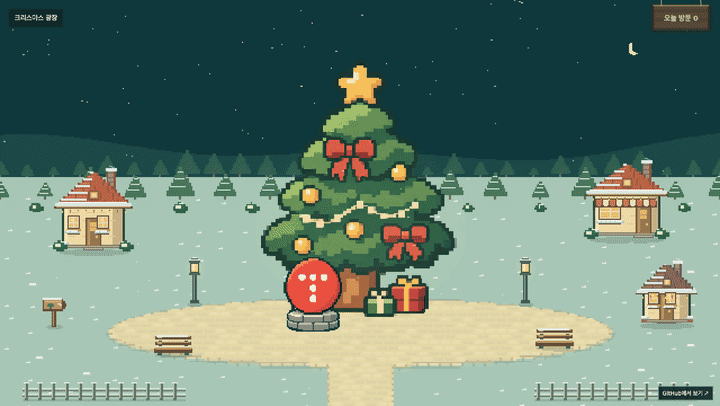

# Pixel Visitor Village

[한국어](README.md) | **English** | [日本語](README.ja.md) | [简体中文](README.zh-CN.md)

[](https://pixel-visitor-village.pages.dev/)

A little pixel village with one character for each visitor counted today on your Tistory blog.

<a href="https://pixel-visitor-village.pages.dev/#demo"></a>

[Install on Tistory](https://pixel-visitor-village.pages.dev/install?lang=en) · [Usage guide (Korean)](https://pixel-visitor-village.pages.dev/docs/)

## 20-second introduction

[](public/media/intro.mp4)

[Watch the video](https://pixel-visitor-village.pages.dev/#intro-film) · [MP4](public/media/intro.mp4)

Visitor counts in the video and demo are demonstration inputs.

## Features

- Display today's aggregate count as 0–5,000 pixel characters.
- Choose Christmas, spring, summer, autumn or winter scenery.
- Watch characters walk and greet each other, with pause and reduced-motion support.

## Installation

1. Open the [installation helper](https://pixel-visitor-village.pages.dev/install?lang=en), enter your blog URL, choose a season and copy the code.
2. Back up your skin, then paste it in Tistory administration → **꾸미기 → 스킨 편집 → HTML 편집** (Appearance → Edit skin → Edit HTML).
3. Check the count and mobile layout on your blog.

The owner must paste the code into the skin. Counts represent today's total, not concurrent presence or individual identity. Installation in an actual Tistory account remains unverified.

## Development

Use Node.js 22.12+ and pnpm 10. Browser tests require Google Chrome.

```bash
pnpm install
pnpm dev
```

[Configuration and API](docs/reference/widget.en.md) · [Development, tests and deployment](docs/reference/widget.en.md#local-development) · [Production and music credits](docs/features/visitor-village/intro-media.md)
