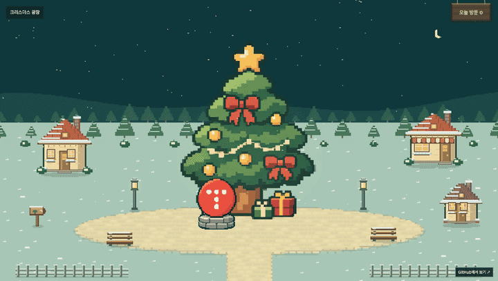
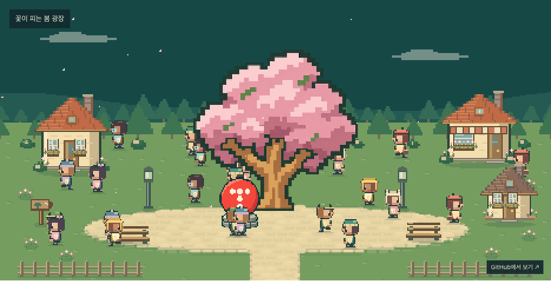
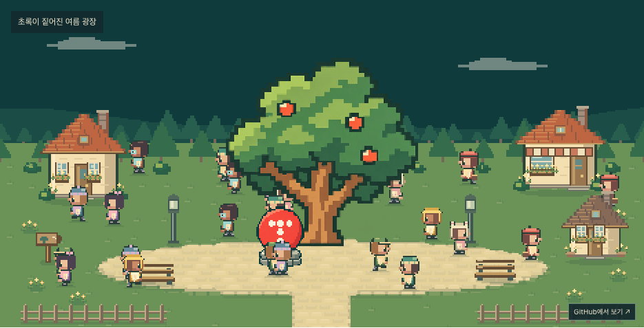
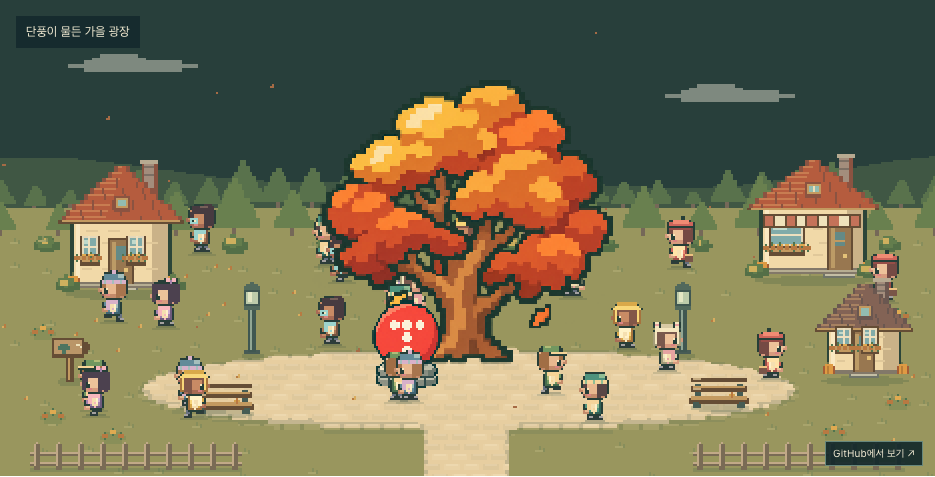
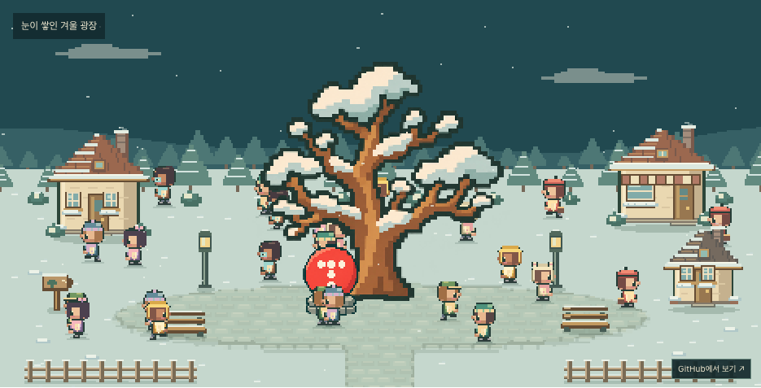
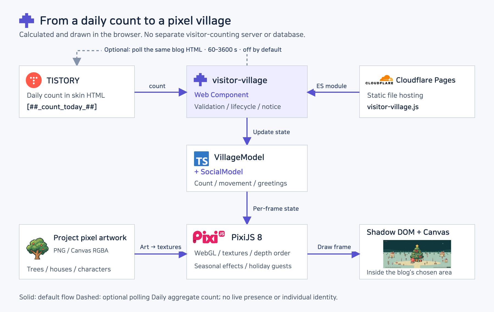
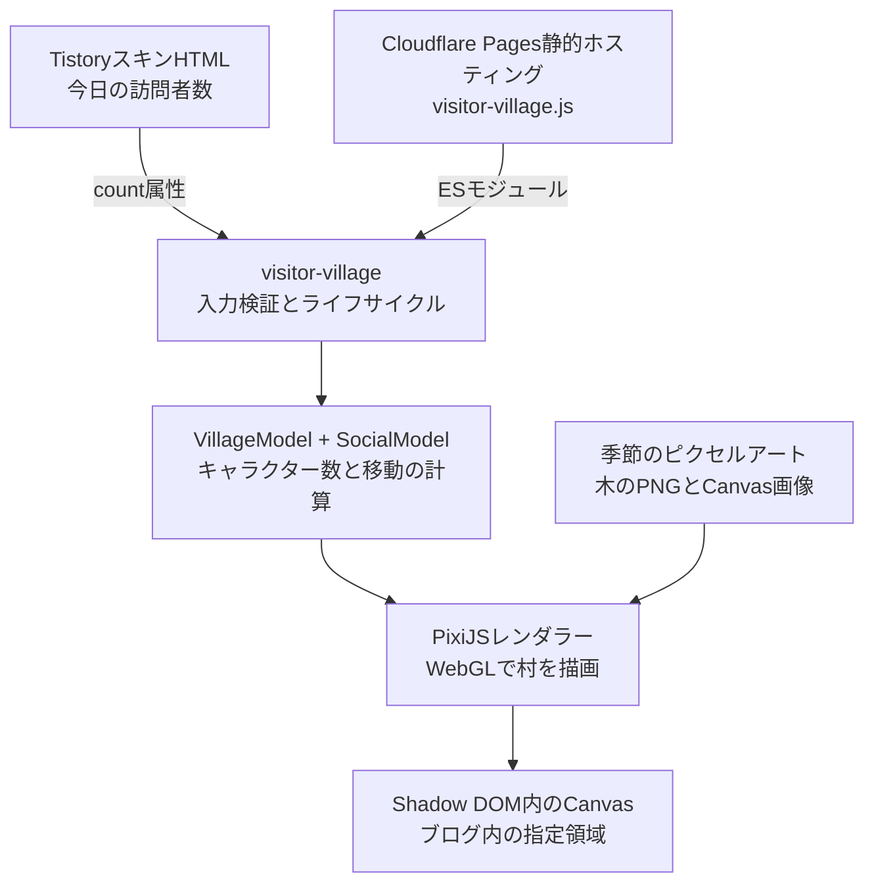

# Pixel Visitor Village

[한국어](README.md) | [English](README.en.md) | **日本語** | [简体中文](README.zh-CN.md)

[](https://pixel-visitor-village.pages.dev/)

**今日のブログ訪問者数が、小さなピクセルの村をにぎやかにします。**

Tistoryブログの今日の訪問者数を、1人につき1体のピクセルキャラクターで表すWebウィジェットです。キャラクターは大きな木の周りを歩いたり休んだりします。クリスマスと四季のテーマを選べます。

<a href="https://pixel-visitor-village.pages.dev/#demo"></a>

[Tistoryに設置する](https://pixel-visitor-village.pages.dev/install.html) | [埋め込みコード](examples/tistory-snippet.html) | [使い方（韓国語）](https://pixel-visitor-village.pages.dev/docs/)

設置ヘルパーと使い方の文書をCloudflare Pagesで提供しています。

[](public/media/intro.mp4)

**20秒の紹介動画** — README内ではGIFが再生されます。クリックすると更新したMP4が開きます。[ポスター](public/media/intro-poster.jpg) | [MP4](public/media/intro.mp4) | [制作情報と音楽の出典](docs/features/visitor-village/intro-media.md)

*小さくしたTistoryのモニュメントがある最新のPixiJSの村と設置画面を実際に撮影しました。あいさつ、吹き出し、サンタと5つの季節を収録しています。0〜24人はデモ入力です。*

> 新しい設置ヘルパーは季節のプレビューと韓国語、英語、日本語、簡体字中国語に対応しています。この改修はCloudflare Pagesに公開し、公開サイトでも確認しました。メインデモ、紹介動画、詳細な技術文書は韓国語です。基本の[韓国語版](README.md)と[英語版](README.en.md)も参照できます。

[主な機能](#主な機能) | [季節ごとの村](#季節ごとの村) | [Tistoryへの設置](#tistoryへの設置) | [仕組み](#仕組み) | [設定](#ウィジェットの設定) | [訪問数の通知](#訪問数の木製プレートと任意の更新) | [開発](#ローカル開発) | [ドキュメント](#ドキュメントと素材)

## 主な機能

- **訪問者数と同じ数のキャラクター** — 0〜5,000人に対応。キャラクターは木の幹を避けながら歩き、時々休みます。
- **5つの木のテーマ** — クリスマス、春、夏、秋、冬から選べます。テーマを変えても訪問者数とキャラクターの位置は維持されます。
- **HTMLで埋め込み** — `<visitor-village>` Web Componentを使います。Shadow DOMでスタイルを分離し、PixiJSで描画します。
- **表示中にアニメーションを再生** — 非表示のタブや画面外では停止します。OSの動きを減らす設定と手動の一時停止にも対応します。
- **ブログ内の指定領域に収まる表示** — レスポンシブなキャンバスで、記事のリンク操作やモバイルでのスクロールを妨げません。

20×28pxのキャラクター8種類は正面/側面/背面と歩行/まばたき/手振りを保ちます。小さな画面は16×22pxアトラスを使います。[現在のスプライトシート](docs/assets/cozy-village/characters-front.png)をご覧ください。

以下は、小さくしたTistoryのモニュメントがある実際の村の画面です。

## 季節ごとの村

日付にかかわらず、初期テーマは**クリスマス**です。デモの木のカスタマイズパネル（나무 꾸미기）で切り替えられます。

改良した背景には瓦屋根、窓枠、店の日よけ、石畳、ベンチを描いています。花、実、落ち葉、雪で季節を表現します。家や小物とキャラクターの前後関係は、足元の位置で決まります。[木と背景の拡大シート](docs/assets/cozy-village/props.png)で細部を確認できます。

<table>
  <tr><th>春</th><th>夏</th></tr>
  <tr>
    <td></td>
    <td></td>
  </tr>
  <tr><th>秋</th><th>冬</th></tr>
  <tr>
    <td></td>
    <td></td>
  </tr>
</table>

## Tistoryへの設置

1. [設置ヘルパー](https://pixel-visitor-village.pages.dev/install.html)でブログURLと初期テーマを指定し、コードをコピーします。
2. 使用中のスキンをバックアップします。Tistory管理画面で **꾸미기 → 스킨 편집 → HTML 편집**（外観 → スキン編集 → HTML編集）を開きます。
3. 村を表示する位置にコードを貼り付けて保存します。実際のブログで訪問者数とモバイル表示を確認します。

ヘルパーは埋め込みコードとブログの管理画面へのリンクを生成します。**ブログ所有者が初回に一度、スキンへコードを貼り付ける必要があります。**

手動で設置する場合は、次のコードを使用します。

```html
<script
  type="module"
  src="https://pixel-visitor-village.pages.dev/widget/visitor-village.js"
></script>

<visitor-village
  count="[##_count_today_##]"
  season="christmas"
  style="display: block; width: 100%; height: 420px;"
></visitor-village>
```

`[##_count_today_##]`は**TistoryのスキンHTML内で**今日の訪問者数に置換されます。外部JavaScriptファイルや通常の記事本文への配置には対応していません。公開ページにプレースホルダーが残る場合は、スキン内の挿入位置を確認してください。Tistoryの自動モバイルスキンを使う場合は、別途設置が必要かどうかも確認してください。

公開デプロイと別オリジンからのウィジェット読み込みは確認済みです。**実際のTistoryアカウントのスキンへの設置確認は、まだ完了していません。**詳しくは[デプロイと設置ガイド（韓国語）](docs/features/visitor-village/deployment.md)をご覧ください。

## 仕組み

Tistoryがページを生成するときに渡す訪問者数を使います。専用の訪問者集計サーバーやデータベースは不要です。

[](docs/assets/architecture/architecture-en.svg)

<details>
<summary>構成のテキスト版</summary>



</details>

| 役割 | 技術とソース |
| --- | --- |
| 埋め込みとスタイル分離 | Web Components、Shadow DOM — [visitor-village.ts](src/visitor-village.ts) |
| 入力検証と移動計算 | TypeScript — [model.ts](src/model.ts) |
| 描画 | PixiJS 8、WebGL — [renderer.ts](src/renderer.ts) |
| 木とティストリーのモニュメント | 5つの季節のPNGとCanvas代替画像 — [village-art.ts](src/village-art.ts)、[art.ts](src/art.ts) |
| 背景と配置 | 地面、家、小物の共有アトラス — [environment.ts](src/environment.ts)、[environment-layout.ts](src/environment-layout.ts)、[pixel-art.ts](src/pixel-art.ts) |
| キャラクターと動作 | 自作RGBAピクセルフレームと共有アトラス — [characters.ts](src/characters.ts)、[character-motion.ts](src/character-motion.ts) |
| 設置コード生成 | ブラウザー内でURLを正規化しコードを生成 — [install-model.ts](src/install-model.ts) |
| ビルドとホスティング | Vite、Cloudflare Pages — [vite.widget.config.ts](vite.widget.config.ts)、[wrangler.jsonc](wrangler.jsonc)、[_headers](public/_headers) |

<details>
<summary>リポジトリ構成</summary>

```text
pixel-visitor-village/
├── README.md / README.en.md / README.ja.md / README.zh-CN.md
├── index.html / install.html   # デモと設置ヘルパー
├── src/                       # ウィジェット、モデル、描画、画像、ヘルパー
├── tests/widget.spec.ts        # ブラウザー統合テスト
├── examples/                  # Tistory埋め込みコード
├── public/embed-example.html  # 独立ページへの埋め込み例
├── public/_headers / 404.html # Pagesヘッダーと存在しないパスの処理
├── wrangler.jsonc             # Pagesプロジェクトと出力設定
├── assets/concepts/           # 木の原案と生成記録
└── docs/
    ├── assets/                # 実際のウィジェットのスクリーンショット
    └── features/visitor-village/ # 要件、設計、進捗、レビュー記録
```

</details>

## ウィジェットの設定

| 属性 | 初期値 | 動作 |
| --- | --- | --- |
| `count` | `0` | 0〜5,000の整数。`1,234`のような正しいカンマ区切りも使えます。不正な値や範囲外の値はエラーを通知し、最後の正常な状態を維持します。 |
| `season` | `christmas` | `christmas`、`spring`、`summer`、`autumn`、`winter`。不正な値では現在の季節を維持します。 |
| `paused` | なし | 属性が存在すると停止します。`paused="false"`でも停止するため、再開するには属性を削除します。 |
| `glow` | 有効 | `glow="false"`でクリスマスツリーのグロー効果を無効にします。画像に描かれた電球の色は残ります。 |
| `refresh-interval` | `0` | 任意の確認間隔（秒）。`0`で無効、`60`から`3600`までの整数で有効になります。不正な値では最後の有効な設定を維持します。 |

## 訪問数の木製プレートと任意の更新

小さな木製プレートが上から降りて、今日の訪問数を表示します。増加時は「今日の訪問 13 (+3)」のように差分を表示します（ウィジェットの表示言語は現在、韓国語です）。同じ数では繰り返し通知せず、韓国時間で日付が変わった場合も新しい訪問として扱いません。村のどこをクリックしても、プロジェクトのリポジトリが新しいタブで開きます。キーボード操作とモバイルのスクロールも維持します。

自動確認は**初期状態では無効**です。既存のタグに`refresh-interval="60"`を追加するか、設置ヘルパーの1分ごとの確認を選びます。`refresh-interval="0"`で無効にできます。表示中に同じブログのオリジンのホームページHTMLを読みます。そのページに有効な訪問数を持つウィジェットが必要で、複数ある場合はすべて同じ数である必要があります。取得したページのスクリプトや画像は実行・読み込みしません。同じ文書内の表示中ウィジェットは1つのリクエストを共有します。失敗時は最後の正常な状態を保ち、再試行間隔を延ばします。

これは日次集計の定期確認であり、個々の訪問イベントを受信する機能ではありません。Tistoryの集計遅延とHTMLの繰り返し取得が統計に与える影響は**未検証**です。この制限を踏まえて有効にしてください。プレート、リンク、更新オプションは公開ウィジェットに反映済みです。既存の設置では以前のモジュールが最大5分間キャッシュされる場合があります。


<details>
<summary>JavaScript APIとイベント</summary>

`visitorCount`、`season`、`ready`、`motionReduced`は読み取り専用です。`getVisitors()`は`{ id, x, y }`の配列のコピーを返します。

| イベント | `detail` |
| --- | --- |
| `village-ready` | `{ count, season, paused }` |
| `village-change` | `{ count, season, paused }` |
| `village-error` | `{ attribute, message }` |

イベントは`bubbles: true`、`composed: true`で伝播します。通知される`paused`状態には、動きを減らす設定も反映されます。詳細は[公開API仕様（韓国語）](docs/features/visitor-village/design.md#첫-버전-공개-계약)をご覧ください。

</details>

## ローカル開発

**Node.js 22.12以上**、**pnpm 10**、ブラウザーテスト用の**Google Chrome**を使用します。

```bash
pnpm install
pnpm dev --port 5174
```

開発URL: <http://127.0.0.1:5174/>

```bash
pnpm test       # 入力、モデル、設置コードの単体テスト
pnpm typecheck  # TypeScriptの型検査
pnpm build     # 型検査後、デモと独立ウィジェットをビルド
pnpm test:e2e  # ビルド結果をChromeで検証
pnpm preview   # http://127.0.0.1:4178/
```

デモと設置ヘルパーは`dist/`、独立ESモジュールは`dist/widget/visitor-village.js`に出力されます。モジュールにはPixiJS、内部スタイル、木の画像を含みます。プレビューサーバーの`/embed-example.html`で、別ページへの埋め込みを確認できます。

ブラウザーテストはインストール済みのChromeをヘッドレスで実行し、モバイルはエミュレーションで確認します。Chromeがない場合はインストールするか、[playwright.config.ts](playwright.config.ts)の`channel`を環境に合わせて変更してください。

自分でホスティングする場合はHTTPSを使い、ウィジェットモジュールのクロスオリジン読み込みを許可してください。`public/_headers`は`/widget/*`にCORSと5分間のキャッシュ・再検証ヘッダーを付けます。デプロイにはWrangler Direct Uploadを使い、GitHubからの自動デプロイは未設定です。設定と検証記録は[デプロイガイド（韓国語）](docs/features/visitor-village/deployment.md)にあります。

## 現在の対応範囲

- **訪問者数:** ページを開いたときに渡された今日の訪問者数を使います。同時接続数や個々の訪問者の身元を表すものではありません。
- **描画:** WebGLが必要です。Canvas 2Dへのフォールバックは未実装です。
- **木のカスタマイズ:** 季節テーマの選択とクリスマスのグロー調整に対応します。クリスマスの装飾は1枚のPNGなので、個別には編集できません。
- **検証範囲:** 公開デプロイとクロスオリジン埋め込みは確認済みです。実際のTistoryスキンへの設置とモバイル実機での検証は未完了です。
- **ライセンス:** このリポジトリの配布ライセンスはまだ決まっていません。

## ドキュメントと素材

以下の詳細文書は韓国語です。

| 文書 | 内容 |
| --- | --- |
| [要件](docs/features/visitor-village/spec.md) | 機能範囲と受け入れ基準 |
| [設計](docs/features/visitor-village/design.md) | 実装構造と公開仕様 |
| [実装計画](docs/features/visitor-village/implementation-plan.md) / [進捗](docs/features/visitor-village/tasks.md) | 作業順序と残りの課題 |
| [デプロイと設置](docs/features/visitor-village/deployment.md) | Cloudflare Pages設定と設置の検証記録 |
| [独立レビュー](docs/features/visitor-village/reviews/) | コードと設置フローのレビュー記録 |
| [木の原案と生成記録](assets/concepts/README.md) | AIで生成したクリスマスツリーの原案とプロンプト |
| [紹介動画の制作情報](docs/features/visitor-village/intro-media.md) | 最新画面のキャプチャ、HyperFrames編集、動画情報と音楽ライセンス |
| [スクリーンショットについて](docs/assets/README.md) | README画像の出典と撮影条件 |

季節の木5種類とティストリーのモニュメントは[src/assets/cozy](src/assets/cozy/)の透過PNGです。生成原画とプロンプトは[制作記録](assets/concepts/cozy/README.md)にあります。代替画像は`src/art.ts`、背景と小物は`src/environment.ts`、キャラクターは`src/characters.ts`で編集します。外部ゲーム素材は使用していません。

## 直角のフレームとクリスマスのゲスト

ウィジェットとデモの角を直角にしています。クリスマステーマでは、自作ピクセルアートのサンタかルドルフが時々現れ、5〜8秒後に消えます。同時に表示するのは1体のみで、実際の訪問者数には含めません。画面外、非表示タブ、手動停止中は演出の時計も止まります。動きを減らす設定や他の季節では表示しません。

近くのキャラクターは時々立ち止まり、向かい合って手を振り、小さなアイコンの吹き出しで反応してから歩き出します。同時に最大3組、小さい画面では1組が交流します。実際の訪問者の身元とは無関係な装飾です。一時停止中は交流も止まり、動きを減らす設定では無効になります。

これらの変更は公開ウィジェットに反映済みです。

## READMEの参考資料

- [Day.js](https://github.com/iamkun/dayjs#readme): 英語を標準にし、冒頭に言語別リンクを置く構成。
- [Mermaid](https://github.com/mermaid-js/mermaid#readme): 翻訳READMEを分け、英語版へ戻るリンクを設ける構成。
- [PixiJS](https://github.com/pixijs/pixijs#readme): 紹介と主な機能の後に、セットアップと使用例を置く流れ。
- [dotLottie Web](https://github.com/LottieFiles/dotlottie-web#readme): 目立つデモリンク、クイックスタート、詳細文書へのリンク。

これらは文書構成の参考にしました。実行画面は実装のキャプチャで、上部のサムネイルは別途生成した紹介イラストです。[画像と生成記録](docs/assets/README.md)も参照してください。
