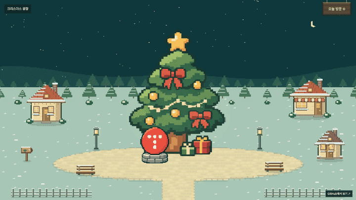
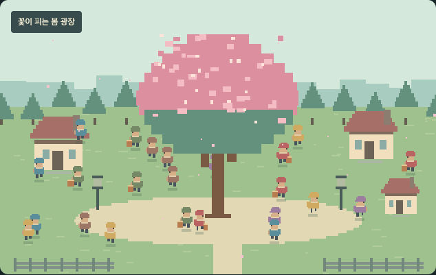
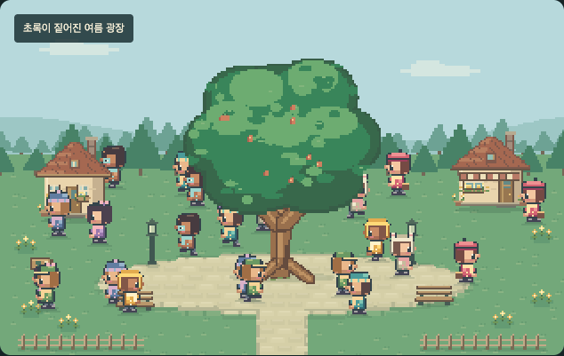
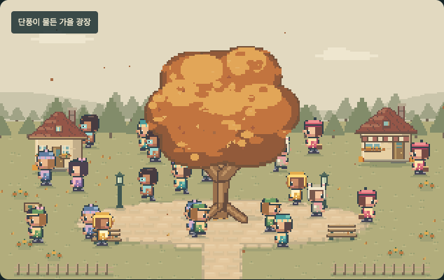
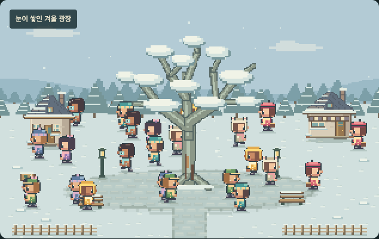
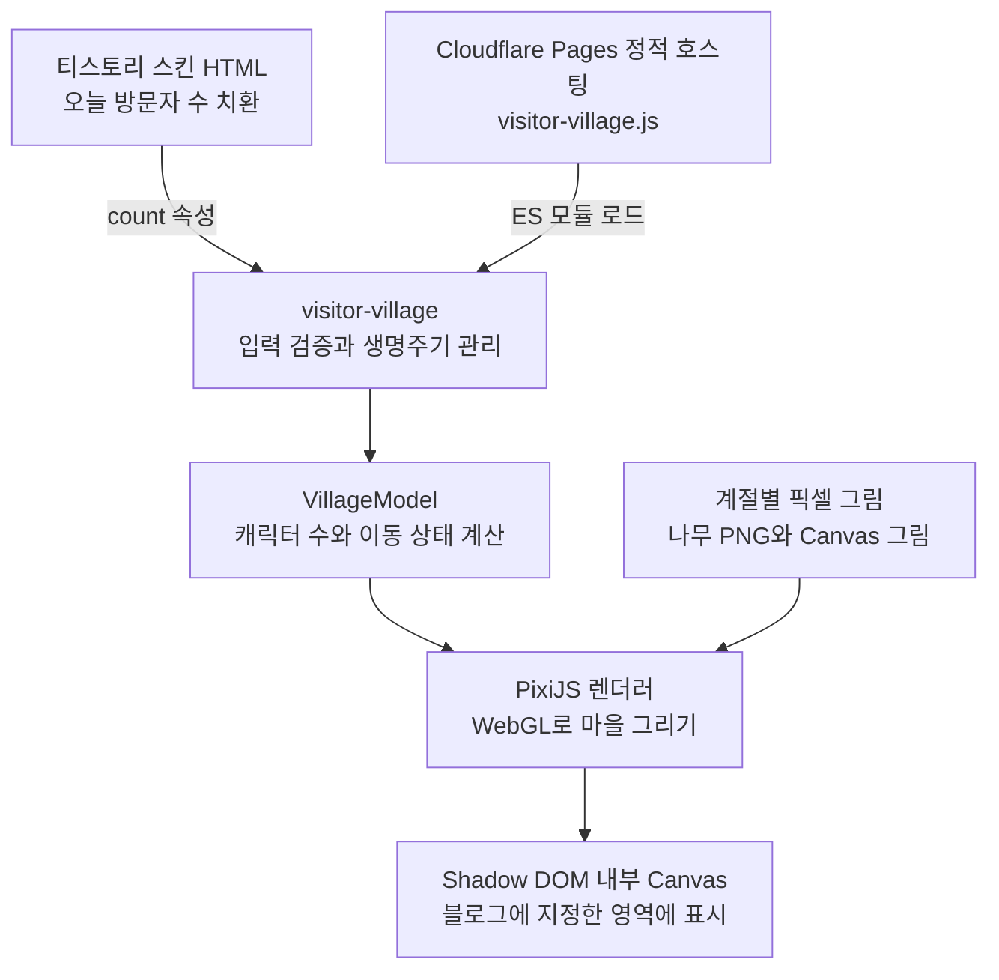

# Pixel Visitor Village

[English](README.md) | **한국어** | [日本語](README.ja.md) | [简体中文](README.zh-CN.md)

**오늘 블로그에 다녀간 사람 수만큼, 작은 마을이 북적입니다.**

티스토리의 오늘 방문자 수를 픽셀 캐릭터로 보여 주는 웹 위젯입니다. 커다란 나무 주변에서 캐릭터들이 걷고 쉬며, 크리스마스부터 사계절까지 마을 분위기를 바꿀 수 있습니다.

[마을 구경하기](https://pixel-visitor-village.pages.dev/) · [티스토리 설치하기](https://pixel-visitor-village.pages.dev/install.html) · [설치 코드](examples/tistory-snippet.html)

[](https://pixel-visitor-village.pages.dev/#intro-film)

**20초 소개 영상** — 위 미리보기는 README에서 자동으로 움직입니다. 클릭하면 데모의 영상 영역으로 이동합니다. [썸네일](public/media/intro-poster.jpg) · [MP4](public/media/intro.mp4) · [제작과 음원 출처](docs/features/visitor-village/intro-media.md)

*실제 마을 그림과 이동 코드를 사용해 Claude Code의 brag 스킬로 제작했습니다. 영상 속 방문자 24명은 시연용 숫자입니다. 소개 영상은 운영 사이트에서 재생할 수 있습니다. 영상은 환경 에셋 개선 전 버전의 고정 렌더입니다.*

> 데모와 설치 도우미의 화면, 소개 영상과 상세 기술 문서는 한국어로 제공됩니다. 이 README는 [영문 기본 문서](README.md)의 한국어판입니다.

[주요 기능](#주요-기능) · [계절별 마을](#계절별-마을) · [티스토리 설치](#티스토리-설치) · [동작 구조](#동작-구조) · [위젯 설정](#위젯-설정) · [로컬 개발](#로컬-개발) · [문서](#문서와-에셋)

## 주요 기능

- **방문자 수만큼 캐릭터 생성** — 0~5,000명을 지원하며, 캐릭터들이 나무를 피해 움직이고 잠시 쉬기도 합니다.
- **계절별 큰 나무** — 크리스마스, 봄, 여름, 가을, 겨울 중 선택합니다. 테마를 바꿔도 방문자 수와 위치를 유지합니다.
- **HTML로 삽입하는 독립 위젯** — iframe 대신 `<visitor-village>` 웹 컴포넌트를 사용합니다. Shadow DOM으로 내부 스타일을 분리하고 PixiJS로 그립니다.
- **화면에 보일 때 움직임 재생** — 숨겨진 탭과 화면 밖에서는 멈춥니다. 운영체제의 모션 줄이기 설정과 수동 정지도 반영합니다.
- **블로그 안의 정해진 영역에 표시** — 반응형 크기를 지원하고, 캔버스가 본문 링크나 모바일 스크롤을 가로채지 않습니다.

의상과 표정이 다른 **20×28px 캐릭터 8종**, 앞/옆/뒤 방향과 4프레임 걷기, 눈 깜박임이 들어 있습니다. 캐릭터 개선은 운영 사이트에 반영됐습니다. [확대 시트](docs/assets/characters-v2.png)와 [실제 마을 적용 화면](docs/assets/village-characters-v2.png)을 볼 수 있습니다. 아래 계절별 이미지는 주변 환경을 개선한 버전의 로컬 캡처입니다. 같은 환경 에셋은 공개 마을에도 반영됐습니다.

## 계절별 마을

기본 테마는 날짜와 관계없이 **크리스마스**입니다. 데모의 ‘나무 꾸미기’에서 바로 바꿔 볼 수 있습니다.

집의 기와 지붕과 창틀, 가게 차양, 돌길과 벤치를 새로 그렸습니다. 꽃과 열매, 낙엽과 눈으로 계절을 구분하고, 집과 소품은 캐릭터의 발 위치에 따라 앞뒤로 표시합니다. [나무와 소품 확대 시트](docs/assets/environment-v2.png)에서 디테일을 볼 수 있습니다.

<table>
  <tr>
    <th>봄 · spring</th>
    <th>여름 · summer</th>
  </tr>
  <tr>
    <td></td>
    <td></td>
  </tr>
  <tr>
    <th>가을 · autumn</th>
    <th>겨울 · winter</th>
  </tr>
  <tr>
    <td></td>
    <td></td>
  </tr>
</table>

## 티스토리 설치

1. [설치 도우미](https://pixel-visitor-village.pages.dev/install.html)에 블로그 주소와 처음 보여 줄 테마를 입력하고 코드를 복사합니다.
2. 사용 중인 스킨을 백업한 뒤, 티스토리 관리자 → **꾸미기 → 스킨 편집 → HTML 편집**을 엽니다.
3. 마을을 표시할 위치에 코드를 붙여 넣고 저장합니다. 실제 블로그에서 방문자 수와 모바일 화면을 확인합니다.

주소를 입력하면 설치 코드와 해당 블로그의 관리자 링크가 만들어집니다. **최초 한 번은 소유자가 스킨에 코드를 붙여 넣어야 합니다.**

직접 설치하려면 아래 코드를 사용합니다.

```html
<script
  type="module"
  src="https://pixel-visitor-village.pages.dev/widget/visitor-village.js"
></script>

<visitor-village
  count="[##_count_today_##]"
  season="christmas"
  style="display: block; width: 100%; height: 420px;"
></visitor-village>
```

`[##_count_today_##]`는 **티스토리 스킨 HTML에서** 오늘 방문자 수로 치환됩니다. 외부 JavaScript 파일이나 일반 글 본문에 넣는 방식은 지원하지 않습니다. 실제 페이지에 치환자가 그대로 보이면 스킨의 삽입 위치를 확인해야 합니다. 자동 모바일 스킨을 사용하는 경우에도 별도 적용 여부를 확인합니다.

Cloudflare Pages 공개 배포와 다른 출처에서의 위젯 로드는 확인했습니다. **실제 티스토리 계정의 스킨 설치 검증은 아직 남아 있습니다.** 자세한 확인 순서는 [배포와 설치 안내](docs/features/visitor-village/deployment.md)를 참고하세요.

## 동작 구조

티스토리가 페이지를 만들 때 넣어 준 방문자 수를 입력으로 사용합니다. 별도 방문자 집계 서버나 데이터베이스는 필요하지 않습니다.



| 역할 | 기술과 파일 |
| --- | --- |
| 삽입과 스타일 분리 | Web Components, Shadow DOM · [visitor-village.ts](src/visitor-village.ts) |
| 입력 검증과 이동 계산 | TypeScript · [model.ts](src/model.ts) |
| 화면 그리기 | PixiJS 8, WebGL · [renderer.ts](src/renderer.ts) |
| 나무 그림 | 크리스마스 PNG와 자체 Canvas 픽셀 그림 · [art.ts](src/art.ts), [themes.ts](src/themes.ts) |
| 마을 환경과 배치 | 바닥, 집과 소품의 공유 아틀라스 · [environment.ts](src/environment.ts), [environment-layout.ts](src/environment-layout.ts), [pixel-art.ts](src/pixel-art.ts) |
| 캐릭터 그림과 동작 | 자체 RGBA 픽셀 프레임과 공유 아틀라스 · [characters.ts](src/characters.ts), [character-motion.ts](src/character-motion.ts) |
| 설치 코드 생성 | 브라우저 안에서 주소 정규화와 코드 생성 · [install-model.ts](src/install-model.ts) |
| 빌드와 배포 | Vite, Cloudflare Pages · [vite.widget.config.ts](vite.widget.config.ts), [wrangler.jsonc](wrangler.jsonc), [_headers](public/_headers) |

<details>
<summary>저장소 구조</summary>

```text
pixel-visitor-village/
├── README.md / README.ko.md / README.ja.md / README.zh-CN.md
├── index.html / install.html    # 데모와 설치 도우미 진입점
├── src/
│   ├── visitor-village.ts       # 공개 웹 컴포넌트
│   ├── model.ts                # 방문자 수 검증과 이동 모델
│   ├── renderer.ts             # PixiJS 화면과 자원 관리
│   ├── art.ts / themes.ts      # 계절 나무와 테마 설정
│   ├── environment.ts          # 지형, 집과 거리 소품 그림
│   ├── environment-layout.ts   # 반응형 소품 배치
│   ├── pixel-art.ts            # 공통 픽셀 그리기 도구
│   ├── characters.ts          # 8종 캐릭터의 픽셀 프레임
│   ├── character-motion.ts    # 방향, 걷기와 표정 선택
│   ├── demo.ts / demo.css      # 마을 시연 화면
│   ├── install*.ts / *.css     # 설치 도우미와 스타일
│   └── assets/                 # 배포용 크리스마스 나무
├── tests/widget.spec.ts        # 브라우저 통합 검증
├── examples/                   # 티스토리 삽입 코드
├── public/embed-example.html   # 독립 삽입 예제
├── public/_headers / 404.html   # Pages 헤더와 없는 경로 처리
├── wrangler.jsonc              # Pages 프로젝트와 출력 설정
├── assets/concepts/            # 나무 원본 시안과 생성 기록
└── docs/
    ├── assets/                 # 실제 화면 캡처
    └── features/visitor-village/ # 명세, 설계, 작업과 검토 기록
```

</details>

## 위젯 설정

| 속성 | 기본값 | 동작 |
| --- | --- | --- |
| `count` | `0` | 0~5,000의 정수. `1,234`처럼 올바른 쉼표 표기도 허용합니다. 잘못된 값이나 범위 초과는 안내하고 마지막 정상 상태를 유지합니다. |
| `season` | `christmas` | `christmas`, `spring`, `summer`, `autumn`, `winter`. 잘못된 값은 기존 계절을 유지합니다. |
| `paused` | 없음 | 속성이 존재하면 정지합니다. `paused="false"`도 정지이므로, 재생하려면 속성을 제거합니다. |
| `glow` | 켜짐 | `glow="false"`로 크리스마스 나무의 빛 번짐을 끕니다. 이미지에 그려진 전구색은 유지합니다. |

<details>
<summary>JavaScript API와 이벤트</summary>

`visitorCount`, `season`, `ready`, `motionReduced`는 읽기 전용입니다. `getVisitors()`는 `{ id, x, y }` 배열의 복사본을 반환합니다.

| 이벤트 | `detail` |
| --- | --- |
| `village-ready` | `{ count, season, paused }` |
| `village-change` | `{ count, season, paused }` |
| `village-error` | `{ attribute, message }` |

이벤트는 `bubbles: true`, `composed: true`로 전파됩니다. `paused` 상태에는 모션 줄이기 설정도 반영됩니다. 전체 계약은 [공개 API 설계](docs/features/visitor-village/design.md#첫-버전-공개-계약)에 있습니다.

</details>

## 로컬 개발

Node.js **22.12 이상**, pnpm **10**, 브라우저 검증용 **Google Chrome**을 사용합니다.

```bash
pnpm install
pnpm dev --port 5174
```

개발 화면: <http://127.0.0.1:5174/>

```bash
pnpm test       # 입력과 모델, 설치 코드의 단위 테스트
pnpm typecheck  # TypeScript 검사
pnpm build     # 타입 검사 후 데모와 독립 위젯 빌드
pnpm test:e2e  # 빌드 결과를 Chrome에서 검증
pnpm preview   # http://127.0.0.1:4178/
```

`dist/`에 데모와 설치 도우미, `dist/widget/visitor-village.js`에 독립 ES 모듈이 생성됩니다. 모듈에는 PixiJS와 내부 스타일, 나무 이미지가 포함됩니다. 미리보기 서버의 `/embed-example.html`에서 별도 페이지 삽입을 확인할 수 있습니다.

브라우저 테스트는 설치된 Chrome을 headless로 실행하며 모바일은 에뮬레이션으로 확인합니다. Chrome이 없는 환경은 설치하거나 [playwright.config.ts](playwright.config.ts)의 `channel`을 조정합니다.

직접 호스팅할 때는 HTTPS와 위젯 모듈의 교차 출처 로드를 허용해야 합니다. Pages의 `public/_headers`는 `/widget/*`에 CORS와 5분 캐시/재검증 헤더를 제공합니다. 배포는 Wrangler로 직접 업로드하며 GitHub 자동 배포는 아직 설정하지 않았습니다. 상세 설정과 배포 확인 기록은 [배포 문서](docs/features/visitor-village/deployment.md)에 있습니다.

## 현재 범위

- **방문자 집계:** 페이지가 열릴 때 전달된 오늘 방문자 수를 사용합니다. 실시간 동시 접속자나 개별 방문자의 신원을 나타내지 않습니다.
- **렌더링:** 위젯은 WebGL을 사용합니다. WebGL을 사용할 수 없는 환경을 위한 Canvas 2D 대체 렌더러는 구현하지 않았습니다.
- **나무 꾸미기:** 계절 테마 선택과 크리스마스 빛 번짐 조절을 지원합니다. 크리스마스 장식은 하나의 PNG여서 장식별 편집은 지원하지 않습니다.
- **확인 범위:** 공개 배포와 교차 출처 삽입은 검증했으며, 실제 티스토리 스킨 설치와 모바일 실기기 검증은 남아 있습니다.
- **라이선스:** 이 저장소의 배포 라이선스는 아직 정하지 않았습니다.

## 문서와 에셋

아래 상세 문서는 한국어로 작성되어 있습니다.

| 문서 | 내용 |
| --- | --- |
| [요구사항](docs/features/visitor-village/spec.md) | 기능 범위와 수용 기준 |
| [설계](docs/features/visitor-village/design.md) | 구현 구조와 공개 계약 |
| [구현 계획](docs/features/visitor-village/implementation-plan.md) / [진행 상태](docs/features/visitor-village/tasks.md) | 작업 순서와 남은 일 |
| [배포와 설치](docs/features/visitor-village/deployment.md) | Cloudflare Pages 설정과 설치 확인 기록 |
| [독립 검토 기록](docs/features/visitor-village/reviews/) | 코드와 설치 흐름 검토 결과 |
| [나무 원본과 생성 기록](assets/concepts/README.md) | AI로 생성한 크리스마스 트리 시안과 프롬프트 |
| [소개 영상 제작과 출처](docs/features/visitor-village/intro-media.md) | Claude Code brag 실행, 영상 정보와 음악 라이선스 |
| [화면 캡처 안내](docs/assets/README.md) | 이 README에 사용한 실제 화면의 출처와 촬영 조건 |

크리스마스 트리의 배포용 이미지는 [src/assets/christmas-tree.png](src/assets/christmas-tree.png)입니다. 다른 계절의 나무는 `src/art.ts`, 지형과 집, 거리 소품은 `src/environment.ts`, 개선 캐릭터는 `src/characters.ts`에서 직접 그립니다. 외부 게임 에셋은 사용하지 않았습니다.

## README 구성 참고

- [Day.js README](https://github.com/iamkun/dayjs#readme): 영문 기본 문서와 상단의 언어별 README 링크를 참고했습니다.
- [Mermaid README](https://github.com/mermaid-js/mermaid#readme): 번역 문서에서 기본 영문 문서로 돌아가는 링크를 참고했습니다.
- [PixiJS README](https://github.com/pixijs/pixijs#readme): 소개와 핵심 기능 다음에 설치와 사용 예제를 배치하는 흐름을 참고했습니다.
- [dotLottie Web README](https://github.com/LottieFiles/dotlottie-web#readme): 상단의 실행 링크, 빠른 시작과 상세 문서 분리를 참고했습니다.

위 레퍼런스의 정보 배치를 참고했으며, 화면 이미지와 프로젝트 설명은 이 저장소의 실제 구현을 기준으로 작성했습니다.
