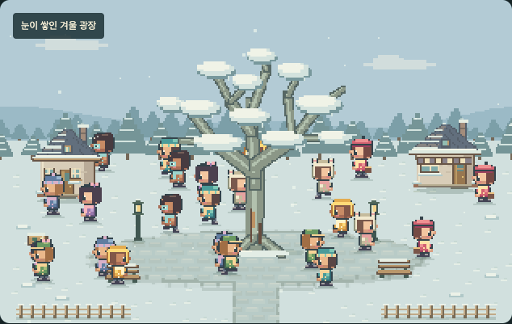
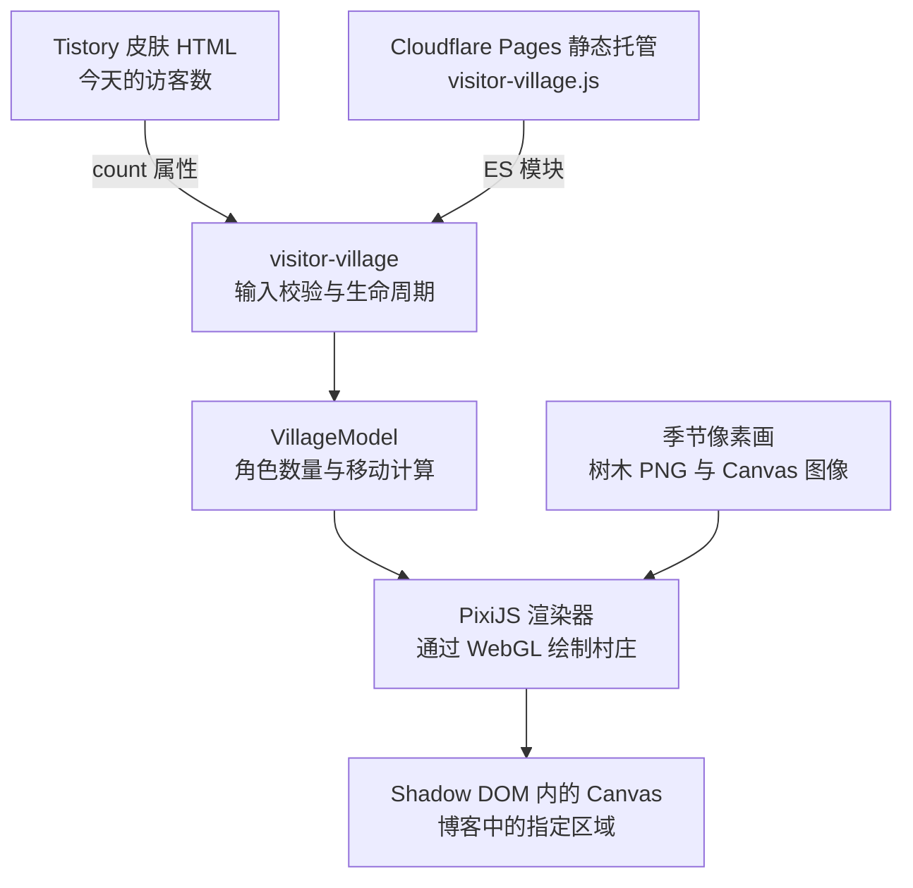

# Pixel Visitor Village

[English](README.md) | [한국어](README.ko.md) | [日本語](README.ja.md) | **简体中文**

**让今天的博客访客数，变成热闹的像素小村庄。**

这是一个为 Tistory 博客制作的网页组件，将今天的访客数转换为相同数量的像素角色。角色会在大树周围散步、休息，你还可以选择圣诞节或四季主题。

[逛逛村庄](https://pixel-visitor-village.pages.dev/) | [安装到 Tistory](https://pixel-visitor-village.pages.dev/install.html) | [嵌入代码](examples/tistory-snippet.html) | [使用文档（韩语）](https://pixel-visitor-village.pages.dev/docs/)

HTML 文档包含安装方法、组件设置、统计规则和问题排查。新版首页和文档已发布到 Cloudflare Pages，并完成公开站点验证。

[](https://pixel-visitor-village.pages.dev/#intro-film)

**20 秒介绍视频** — GIF 会在 README 中播放，点击后可进入演示页面的视频区域。[封面](public/media/intro-poster.jpg) | [MP4](public/media/intro.mp4) | [制作信息与音乐来源](docs/features/visitor-village/intro-media.md)

*使用项目本身的村庄画面与移动代码，通过 Claude Code 的 brag 技能制作。视频中的 24 位访客是演示数据。视频可在公开站点播放，是场景素材更新前制作的固定渲染版本。*

> 新版安装助手提供四季预览，支持韩语、英语、日语和简体中文。本次改版已发布到 Cloudflare Pages，并完成公开站点验证。主演示页面、介绍视频和详细技术文档仍为韩语。本 README 是[英文默认文档](README.md)的简体中文译本。

[主要功能](#主要功能) | [四季村庄](#四季村庄) | [安装到 Tistory](#安装到-tistory) | [工作原理](#工作原理) | [配置](#组件配置) | [访客数木牌](#访客数木牌与可选更新) | [开发](#本地开发) | [文档](#文档与素材)

## 主要功能

- **一位访客对应一个角色** — 支持 0–5,000 位访客。角色会绕开树干行走，并不时停下来休息。
- **五种大树主题** — 可选圣诞节、春、夏、秋、冬。切换主题会保留访客数和角色位置。
- **通过 HTML 嵌入** — 使用 `<visitor-village>` Web Component，以 Shadow DOM 隔离样式，并通过 PixiJS 绘制。
- **可见时播放动画** — 标签页隐藏或组件离开可视区域时暂停，支持系统的减少动态效果设置和手动暂停。
- **融入博客布局** — 在指定区域内响应式显示，不妨碍正文链接操作或手机滚动。

提供 **8 种 20×28px 角色**，拥有不同的服装和表情，支持正面、侧面、背面、四帧行走和眨眼。更新后的角色已上线，可查看[放大精灵图](docs/assets/characters-v2.png)和[村庄中的显示效果](docs/assets/village-characters-v2.png)。

下方的季节截图是改进场景后的本地截图，同一套场景素材已在公开站点上线。

## 四季村庄

默认主题始终是**圣诞节**，不随日期自动切换。可以在演示页面的树木装饰面板（나무 꾸미기）中更换主题。

改进后的场景包含瓦屋顶、窗框、商店遮阳棚、石板路和长椅。花朵、果实、落叶和积雪区分四季。房屋、道具与角色之间的前后遮挡关系，根据脚部位置排序。细节见[树木与场景放大图](docs/assets/environment-v2.png)。

<table>
  <tr><th>春</th><th>夏</th></tr>
  <tr>
    <td></td>
    <td></td>
  </tr>
  <tr><th>秋</th><th>冬</th></tr>
  <tr>
    <td></td>
    <td></td>
  </tr>
</table>

## 安装到 Tistory

1. 打开[安装助手](https://pixel-visitor-village.pages.dev/install.html)，输入博客地址，选择初始主题，然后复制代码。
2. 备份当前皮肤。在 Tistory 管理页面打开 **꾸미기 → 스킨 편집 → HTML 편집**（外观 → 编辑皮肤 → 编辑 HTML）。
3. 将代码粘贴到希望显示村庄的位置并保存。在实际博客中检查访客数和手机布局。

安装助手会生成嵌入代码和博客管理页面链接。**博客所有者需要在首次安装时手动将代码粘贴到皮肤中。**

如需手动安装，可使用：

```html
<script
  type="module"
  src="https://pixel-visitor-village.pages.dev/widget/visitor-village.js"
></script>

<visitor-village
  count="[##_count_today_##]"
  season="christmas"
  style="display: block; width: 100%; height: 420px;"
></visitor-village>
```

Tistory 会在**皮肤 HTML 内**将 `[##_count_today_##]` 替换为今天的访客数。不支持将其放入外部 JavaScript 文件或普通文章正文。若发布后的页面仍保留该占位符，请检查代码在皮肤中的插入位置。使用 Tistory 自动手机皮肤时，还需确认是否要单独安装。

公开部署和跨来源加载组件已验证。**在实际 Tistory 账号皮肤中的安装仍待验证。**详细步骤见[部署与安装指南（韩语）](docs/features/visitor-village/deployment.md)。

## 工作原理

组件使用 Tistory 生成页面时提供的访客数，无需额外的访客统计服务器或数据库。



| 职责 | 技术与源码 |
| --- | --- |
| 嵌入与样式隔离 | Web Components、Shadow DOM — [visitor-village.ts](src/visitor-village.ts) |
| 输入校验与移动计算 | TypeScript — [model.ts](src/model.ts) |
| 画面渲染 | PixiJS 8、WebGL — [renderer.ts](src/renderer.ts) |
| 树木绘制 | 圣诞树 PNG 与原创 Canvas 像素画 — [art.ts](src/art.ts)、[themes.ts](src/themes.ts) |
| 场景与布局 | 地面、房屋和道具的共享图集 — [environment.ts](src/environment.ts)、[environment-layout.ts](src/environment-layout.ts)、[pixel-art.ts](src/pixel-art.ts) |
| 角色与动作 | 原创 RGBA 像素帧和共享图集 — [characters.ts](src/characters.ts)、[character-motion.ts](src/character-motion.ts) |
| 安装代码生成 | 在浏览器内规范化地址并生成代码 — [install-model.ts](src/install-model.ts) |
| 构建与托管 | Vite、Cloudflare Pages — [vite.widget.config.ts](vite.widget.config.ts)、[wrangler.jsonc](wrangler.jsonc)、[_headers](public/_headers) |

<details>
<summary>仓库结构</summary>

```text
pixel-visitor-village/
├── README.md / README.ko.md / README.ja.md / README.zh-CN.md
├── index.html / install.html   # 演示与安装助手
├── src/                       # 组件、模型、渲染器、图像和安装助手
├── tests/widget.spec.ts        # 浏览器集成测试
├── examples/                  # Tistory 嵌入代码
├── public/embed-example.html  # 独立页面嵌入示例
├── public/_headers / 404.html # Pages 响应头与不存在路径的处理
├── wrangler.jsonc             # Pages 项目与输出配置
├── assets/concepts/           # 树木原始方案与生成记录
└── docs/
    ├── assets/                # 实际组件截图
    └── features/visitor-village/ # 需求、设计、任务与评审记录
```

</details>

## 组件配置

| 属性 | 默认值 | 行为 |
| --- | --- | --- |
| `count` | `0` | 0 到 5,000 的整数，也接受 `1,234` 这样的规范千位分隔格式。无效或超出范围的输入会报告错误，并保留上一次有效状态。 |
| `season` | `christmas` | `christmas`、`spring`、`summer`、`autumn`、`winter`。无效值会保留当前季节。 |
| `paused` | 无 | 只要属性存在就会暂停，包括 `paused="false"`。恢复播放时需移除该属性。 |
| `glow` | 开启 | 设为 `glow="false"` 可关闭圣诞树的辉光效果，图片中原有的灯泡颜色仍会保留。 |
| `refresh-interval` | `0` | 可选检查间隔（秒）。`0` 为关闭，支持 `60` 至 `3600` 的整数。无效值会保留上一次有效设置。 |

## 访客数木牌与可选更新

小木牌会从上方落下，显示今天的访客数。增加时显示差值，例如“今日访问 13 (+3)”（组件目前使用韩语标签）。数值相同不会重复通知，韩国时间跨日后的数值也不会被当作新访客。点击村庄任意位置，可在新标签页打开项目仓库，同时保留键盘操作和手机滚动。

自动检查**默认关闭**。可在现有标签中添加 `refresh-interval="60"`，或在安装助手中勾选每分钟检查。使用 `refresh-interval="0"` 可关闭。组件仅在可见时读取当前博客同源的首页 HTML。首页必须包含访客数有效的组件，若有多个组件，其数值必须一致。读取的页面不会执行脚本或加载图片。同一文档中可见的组件共享一次请求；失败时保留最后有效状态，并延长重试间隔。

这是一项定期检查每日统计的功能，不会接收每位访客到达的事件。Tistory 的统计延迟以及重复读取 HTML 是否影响统计，**尚未验证**。请了解这一限制后再启用。木牌、仓库链接和更新选项已包含在公开组件中。已安装的博客可能会将旧模块缓存最多 5 分钟。


<details>
<summary>JavaScript API 与事件</summary>

`visitorCount`、`season`、`ready` 和 `motionReduced` 为只读属性。`getVisitors()` 返回 `{ id, x, y }` 数组的副本。

| 事件 | `detail` |
| --- | --- |
| `village-ready` | `{ count, season, paused }` |
| `village-change` | `{ count, season, paused }` |
| `village-error` | `{ attribute, message }` |

事件设置了 `bubbles: true` 和 `composed: true`。报告的 `paused` 状态也包含系统减少动态效果的设置。完整说明见[公开 API 约定（韩语）](docs/features/visitor-village/design.md#첫-버전-공개-계약)。

</details>

## 本地开发

使用 **Node.js 22.12 或更高版本**、**pnpm 10**，以及用于浏览器测试的 **Google Chrome**。

```bash
pnpm install
pnpm dev --port 5174
```

开发地址：<http://127.0.0.1:5174/>

```bash
pnpm test       # 输入、模型与安装代码的单元测试
pnpm typecheck  # TypeScript 类型检查
pnpm build     # 类型检查后构建演示与独立组件
pnpm test:e2e  # 在 Chrome 中验证构建结果
pnpm preview   # http://127.0.0.1:4178/
```

演示和安装助手输出到 `dist/`，独立 ES 模块输出到 `dist/widget/visitor-village.js`。模块包含 PixiJS、内部样式和树木图片。可在预览服务器的 `/embed-example.html` 中检查独立页面嵌入效果。

浏览器测试以无头模式运行已安装的 Chrome，手机测试使用模拟环境。若未安装 Chrome，请先安装，或调整 [playwright.config.ts](playwright.config.ts) 中的 `channel`。

自行托管时需要使用 HTTPS，并允许跨来源加载组件模块。`public/_headers` 为 `/widget/*` 添加 CORS 和五分钟缓存及重新验证响应头。部署使用 Wrangler Direct Upload，尚未配置 GitHub 自动部署。配置和验证记录见[部署指南（韩语）](docs/features/visitor-village/deployment.md)。

## 当前范围

- **访客数：** 使用打开页面时传入的今日访客数，不代表同时在线人数或具体访客身份。
- **渲染：** 需要 WebGL，尚未实现 Canvas 2D 回退渲染器。
- **树木装饰：** 支持季节主题和圣诞树辉光控制。圣诞装饰位于同一张 PNG 中，不支持单独编辑。
- **验证：** 已验证公开部署与跨来源嵌入，实际 Tistory 皮肤安装和手机真机测试仍待完成。
- **许可证：** 本仓库尚未确定分发许可证。

## 文档与素材

以下详细文档为韩语。

| 文档 | 内容 |
| --- | --- |
| [需求](docs/features/visitor-village/spec.md) | 功能范围与验收标准 |
| [设计](docs/features/visitor-village/design.md) | 实现结构与公开约定 |
| [实施计划](docs/features/visitor-village/implementation-plan.md) / [进度](docs/features/visitor-village/tasks.md) | 工作顺序与待办事项 |
| [部署与安装](docs/features/visitor-village/deployment.md) | Cloudflare Pages 配置和安装验证记录 |
| [独立评审](docs/features/visitor-village/reviews/) | 代码和安装流程的评审记录 |
| [树木原案与生成记录](assets/concepts/README.md) | AI 生成的圣诞树方案及提示词 |
| [介绍视频制作信息](docs/features/visitor-village/intro-media.md) | Claude Code brag 制作记录、视频信息和音乐许可证 |
| [截图说明](docs/assets/README.md) | README 图片来源与拍摄条件 |

分发用圣诞树图片为 [src/assets/christmas-tree.png](src/assets/christmas-tree.png)。其他季节的树木由 `src/art.ts` 绘制，场景由 `src/environment.ts` 绘制，改进后的角色由 `src/characters.ts` 绘制。未使用外部游戏素材。

## 直角边框与圣诞访客

组件和演示页面改用直角边框。在圣诞主题中，原创像素圣诞老人或鲁道夫会偶尔出现，停留 5–8 秒后消失。同一时间只显示一个装饰角色，不会计入实际访客数。离开可视区域、标签页隐藏或手动暂停时，演出计时也会暂停。启用减少动态效果或切换到其他季节后隐藏。

相近的角色会偶尔停下，面对彼此挥手，再通过小图标气泡互动，然后继续行走。同时最多3对，小屏幕最多1对。这些是与真实访客身份无关的装饰效果。暂停时互动也会停止，启用减少动态效果后禁用互动。

这些改动已包含在公开组件中。

## README 参考

- [Day.js](https://github.com/iamkun/dayjs#readme)：以英文为默认文档，在顶部提供各语言链接。
- [Mermaid](https://github.com/mermaid-js/mermaid#readme)：使用独立翻译版 README，并提供返回英文版的链接。
- [PixiJS](https://github.com/pixijs/pixijs#readme)：先介绍项目与功能，再提供安装和使用示例。
- [dotLottie Web](https://github.com/LottieFiles/dotlottie-web#readme)：突出展示演示链接、快速开始和详细文档入口。

以上项目仅用于参考文档结构。截图与产品说明均来自本项目的实际实现。
