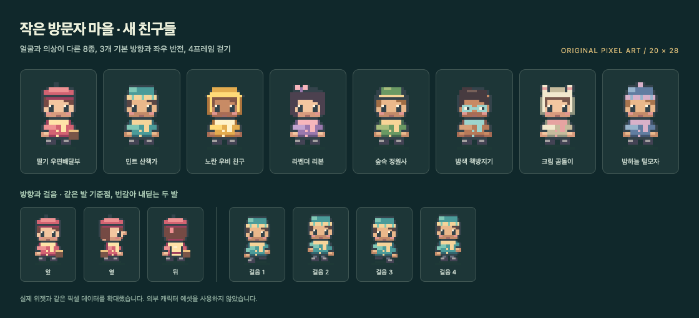

# 방문자 픽셀 위젯 설계 초안

상태: 2026-11-20 사용자가 마을 설계 미리보기를 확인한 뒤 “진행해줘”로 구현 승인. 아래 공개 계약을 구체화해 구현한다.

## 접근 방식

| 방식 | 장점 | 부담과 판단 |
| --- | --- | --- |
| Web Components + PixiJS | 전용 태그로 설치하고 위젯 내부 스타일을 분리한다. 프레임 애니메이션을 사용하기 좋다. | 추천안. 이동과 행동 규칙은 직접 작성한다. |
| Web Components + Canvas 2D | 렌더링 라이브러리 없이 단순한 위젯을 만든다. | 작은 시제품의 대안. 에셋과 애니메이션 관리도 직접 구현한다. |
| Web Components + Phaser | 장면과 충돌, 물리 기능을 활용한다. | 미니게임까지 확장할 때 재검토한다. |
| iframe | 별도 문서를 삽입한다. | 이전에 검토한 대안. 이번 조사에서는 iframe 외의 방식을 우선 제안했다. |

Lit은 설정 UI가 복잡해질 때 고려한다. 현재는 기본 Custom Elements API로 충분한지 먼저 확인한다.

## 추천 구조

```text
티스토리 skin.html의 오늘 방문자 수 치환자
  → <visitor-village count="숫자">
  → Custom Element가 입력을 검증
  → Shadow DOM 내부 Canvas에 PixiJS로 그림
  → 캐릭터별 걷기와 쉬기 상태를 갱신
```

Shadow DOM은 위젯 내부 스타일의 충돌을 줄이는 수단이다. iframe과 같은 보안 격리를 제공하지 않는다.

PixiJS는 WebGL 렌더러를 우선 검토한다. WebGPU와 OffscreenCanvas/Worker는 실제 성능 측정 후 필요할 때 도입한다.

## 중앙 나무의 짧은 설계안

사용자 요청: 마을 중앙에 큰 나무를 두고 계절별로 꾸밀 수 있게 한다. 첫 장식은 크리스마스 트리다.

### 방식과 선택 제안

- **공통 기준점 + 계절별 잎/장식 레이어:** 위치와 캐릭터 배치는 유지하고 장식만 교체한다. 권장안이다.
- **계절마다 완성된 나무 이미지 전체 교체:** 처음 만들기 쉽지만 장식별 효과와 일관된 배치 관리가 어려워질 수 있다.

중앙 기준점을 고정하고 계절별 외형을 교체하는 구조로 구현한다. 크리스마스 외형은 현재 합성 PNG이므로 전구별 이미지 편집 기능은 제공하지 않는다.

### 보이는 모습

```text
              황금 별
          큰 크리스마스 나무
        빨강·금색 장식과 전구
             줄기와 선물
      캐릭터들이 오가는 중앙 광장
```

- 나무는 캐릭터보다 크게 두고 마을의 중심 볼거리로 만든다. 나무 아래 기준점을 광장 중앙에 고정하고 작은 화면에서도 별과 나무 밑동이 잘리지 않게 맞춘다.
- 현재 크리스마스 장식은 황금 별, 빨강/금색 장식, 따뜻한 전구와 나무 아래 선물로 구성한다. 크리스마스 테마는 날짜로 자동 해제하지 않는다.
- 나무 앞을 지나는 캐릭터는 나무 앞에, 뒤쪽을 지나는 캐릭터는 나무 뒤에 보이게 발 위치를 기준으로 정렬한다. 이동 장애물은 광장 전체가 아니라 줄기 주변으로 제한한다.
- 계절별 꾸미기는 먼저 설정값으로 교체하는 구조로 만든다. 봄·여름·가을·겨울의 구체적인 그림과 편집 UI는 아직 확정하지 않았다.
- 장식 변경은 방문자 수와 캐릭터 상태를 보존한다. 이미지나 테마 로드 실패 시 마지막 정상 나무를 유지하거나 장식 없는 기본 나무를 보여 주는 처리를 제안한다.
- 전구 효과를 추가할 경우 은은하게 변화시키고 모션 줄이기 설정에서는 정지한다.

### 시각 자료와 승인 범위

[크리스마스 나무 시안](../../../assets/concepts/christmas-tree-v1.png)을 생성했다. 투명 배경 PNG이며 단일 합성 이미지다. 계절 레이어와 애니메이션, 마을 화면을 구현한 결과가 아니다. [생성 기록](../../../assets/concepts/README.md)에 프롬프트와 상태를 기록한다.

확인받을 범위는 **이 나무의 시각적 방향, 중앙 광장 배치와 계절 레이어 교체 구조**다. 2026-11-20 사용자의 진행 승인 후 실제 위젯과 시연 화면을 구현했다.

## 데이터 계약 제안

- `count`: 0 이상의 정수. 오늘 방문자 수를 뜻한다. 허용할 표시 형식과 최대 수는 구현 전에 확정한다.
- 스킨 HTML에서 티스토리 치환자를 처리하여 전달한다. 외부 JS 파일에서 치환자 처리를 기대하지 않는다.
- 첫 버전의 캐릭터 수는 페이지를 열었을 때 전달된 값이다. 이 값만으로 실시간 집계나 날짜 변경 시 갱신을 보장하지 않는다.
- 공개 데이터 API, 인증키와 별도 방문자 추적 서버는 첫 버전의 필수 구성으로 두지 않는다.
- 예시 태그 이름과 속성은 제안이며 공개 API로 확정하지 않았다.

## 실패 처리와 수명 주기

구현 시 잘못된 입력, 에셋 로드 실패와 렌더러 초기화 실패를 위젯 안에서 처리한다. 요소가 제거되면 애니메이션과 렌더러 자원을 해제한다. 화면 밖과 숨겨진 탭에서는 갱신을 줄이는 방식을 검토한다.

## 확인하지 않은 경계

- 대상 티스토리 스킨에서의 치환자 처리 위치와 스크립트 로드.
- 모바일 화면과 자동 모바일 스킨에서의 노출.
- 실제 캐릭터 수에 따른 프레임 속도와 블로그 스크롤 영향.
- 활동 영역을 페이지 전체로 선택할 경우의 클릭 통과와 레이아웃 연결.

## 공식 근거

2026-11-20 대화에서 아래 공식 문서를 확인했다. 사용 빈도 순위를 조사한 결과는 아니다.

- [티스토리 스킨 파일 구조](https://tistory.github.io/document-tistory-skin/common/files.html)
- [티스토리 오늘 방문자 수](https://tistory.github.io/document-tistory-skin/sidebar/count.html)
- [Chrome: Web Components](https://developer.chrome.com/docs/modern-web-guidance/guides/html/web-components)
- [Lit: 기존 프로젝트에 추가](https://lit.dev/docs/tools/adding-lit/)
- [PixiJS: 렌더러와 운영용 권장 사항](https://pixijs.com/8.x/guides/components/renderers)
- [PixiJS: AnimatedSprite](https://pixijs.download/v8.10.0/docs/scene.AnimatedSprite.html)
- [Phaser: 물리 엔진](https://docs.phaser.io/phaser/concepts/physics)
- [MDN: OffscreenCanvas](https://developer.mozilla.org/en-US/docs/Web/API/OffscreenCanvas)

## 첫 버전 공개 계약

- `count`: 생략/빈 문자열은 0. 공백을 제거한 숫자 또는 올바른 3자리 쉼표 표기만 허용한다. 0~5,000명 지원, 초과/미치환/음수/소수는 명시적 오류이며 마지막 정상 모델을 보존한다.
- `season`: 생략은 `christmas`. 허용값은 `christmas`, `spring`, `summer`, `autumn`, `winter`. 잘못된 값은 오류이며 기존 계절을 보존한다. 제거하면 기본값으로 돌아간다.
- `paused`: 존재하면 수동 정지, 제거하면 재생한다. 모션 줄이기, 숨겨진 탭과 화면 밖 상태는 수동 재생과 관계없이 루프를 중지한다.
- `glow`: 기본 켜짐, 문자열 `false`일 때 빛 번짐 효과를 끈다. 합성 PNG에 그려진 전구색 자체는 지우지 않는다.
- `visitorCount`, `season`, `ready`, `motionReduced`는 읽기 전용이다. `getVisitors()`는 `{id,x,y}` 배열의 복사본이며 외부 변경은 내부 상태에 영향을 주지 않는다.
- `village-change`: bubbles/composed 이벤트, detail은 `{count,season,paused}`이며 paused는 모션 줄이기까지 반영한다. `village-error`: 같은 전파 방식, detail은 `{attribute,message}`. `village-ready`: 렌더러 준비 시 같은 상태 detail을 보낸다. 프레임별 이벤트는 보내지 않는다.
- 크리스마스는 합성 PNG 외형, 다른 계절은 직접 그린 픽셀 외형을 공통 기준점에서 교체한다. 장식별로 분리된 에셋을 완성했다고 기록하지 않는다. 계절 전환은 캐릭터 모델을 재생성하지 않는다.
- `step(seconds)`는 초 단위이며 비정상/음수는 무시하고 한 번에 최대 0.05초만 반영한다. 캐릭터 중심 범위는 x=0.035~0.965, 발 y=0.51~0.94. 줄기 장애물은 x=0.46~0.54, y=0.73~0.83이다.
- `getTreeLayout(width,height)`는 `{x: width/2, base: height*0.8, size: min(width*0.74,height*0.69)}`이며 0너비/0높이는 0 크기로 처리한다. 모델은 화면 크기와 독립적인 정규화 좌표를 유지한다.

## 렌더러와 입력 복구

초기화 세대가 바뀌면 이미지 대기 직후와 GPU 초기화 직후 유효성을 검사한다. 폐기된 세대는 추가 GPU 생성과 DOM 반영을 하지 않는다. 이미지 로드 실패는 WebGL 실패와 구분하며 기본 나무로 대체한다. 입력 오류는 속성별로 관리하고 수정/제거한 오류만 지운다. 비대화형 캔버스는 포인터 이벤트를 받지 않고 터치 스크롤을 허용한다.

## 설치 도우미와 배포

`install.html`은 티스토리 기본 주소 또는 개인 도메인을 입력받는다. 정규화한 HTTPS origin에서 `/manage` 관리자 링크를 만들고 공개 배포 호스트의 `/widget/visitor-village.js`가 들어간 HTML을 생성한다. 방문자 수는 시연 숫자 대신 `[##_count_today_##]`를 유지한다. URL은 로컬에서만 처리하고 원격 스킨을 쓰지 않는다. 생성된 코드는 textarea.value로 표시하며 주소와 상태 문구는 textContent로 표시한다.

모듈 URL은 설치 페이지 자신의 URL을 기준으로 계산한다. 계절은 기존 5개 허용값만 사용한다. 블로그 URL은 http/https와 공개 호스트명만 허용하며 계정 정보가 있는 URL, IP, localhost와 임의 포트를 거부한다.

공개 배포 대상은 확인한 `hyunolike` 계정의 `hyunho-jangs-projects` 팀, 새 `pixel-visitor-village` 프로젝트다. 사용자가 Vercel 공개 배포를 명시적으로 요청했다. 비로그인 HTTPS 접근과 실제 CORS 응답을 배포 후 검증한다.

## 2026-11-20 캐릭터 개선 설계

### 조사와 선택

- [SLYNYRD Pixelblog 22](https://www.slynyrd.com/blog/2019/10/21/pixelblog-22-top-down-character-sprites): 작은 캐릭터에서 큰 머리와 표현을 강조하고, 앞/뒤/옆 기본 방향과 4프레임 걷기를 먼저 정리하는 방법을 참고한다.
- [SLYNYRD Pixelblog 55](https://www.slynyrd.com/blog/2025/3/24/pixelblog-55-top-down-character-animation): 방향별 몸 비율과 머리/팔 동작을 비교하고, 움직임에서 읽히도록 세부를 단순화하는 과정을 참고한다.

기존 13×19px 두 자세를 보완하는 방식은 얼굴과 방향 표현 공간이 부족하다. 외부 완성 스프라이트 사용은 현재 마을의 색과 자체 제작 원칙에 맞추기 어렵다. 20×28px 원본에 자체 픽셀 프레임을 제작하고 PixiJS의 기존 2배 화면 배율을 유지한다. 이 해상도와 종류 수는 요청 범위 안에서 구현자가 선택했다.

### 구성과 계약

`characters.ts`는 DOM 없이 RGBA 픽셀 프레임을 만든다. 머리는 몸의 약 절반 크기이며 짙은 외곽선, 눈, 볼, 머리/모자, 옷 명암과 작은 소품을 사용한다. 8종은 머리 모양과 의상으로 구분하고 ID로 안정적으로 선택한다. 정지 0, 걷기 1~4, 눈 깜박임 5의 6자세를 앞/옆/뒤 3방향으로 제작한다.

`character-motion.ts`는 모델의 걷기 조건과 같은 정지/걷기를 선택하고 픽셀 좌표계의 속도로 방향을 정한다. 측면만 좌우 반전한다. 모션 시간은 기존 모델 elapsed를 사용하므로 수동 정지와 모션 줄이기에서 표정도 정지한다. 그림의 들썩임은 프레임 안에서 처리해 위치와 깊이 정렬을 바꾸지 않는다.

`renderer.ts`는 144개의 20×28px 프레임을 120×672px Canvas 아틀라스에 배치한다. 모든 프레임은 GPU 소스 한 개를 공유한다. 방문자 수 변경은 Sprite 생성/제거만 수행하며 테마 변경은 캐릭터 아틀라스를 교체하지 않는다. 해제 시 프레임 Texture를 해제한 다음 공유 소스를 한 번 해제한다. 별도 다운로드 에셋이나 런타임 의존성을 추가하지 않는다.

확대 그림과 실제 마을 화면을 함께 검토한다. 실제 티스토리 설치를 검증했다고 기록하지 않으며 이번 작업은 자동으로 공개 배포하지 않는다.

### 구현 결과 미리보기




위 이미지는 개선한 로컬 개발 버전이며 공개 배포 전이다. 촬영 조건은 [화면 캡처 안내](../../assets/README.md#캐릭터-개선-개발-화면)에 기록했다.
