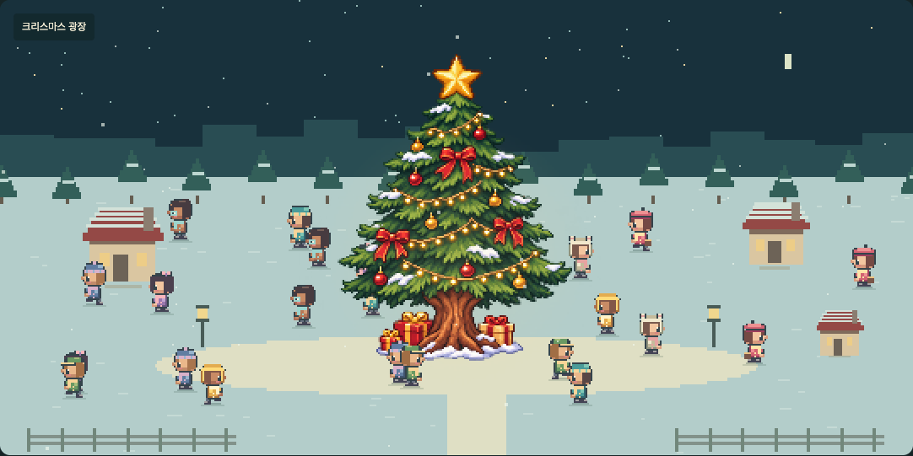

# 방문자 픽셀 위젯 설계 초안

## 2026-11-25 서비스 타이포그래피

사용자가 폰트 변경을 요청했다. 모든 문구를 픽셀체로 바꾸면 긴 설치 안내가 어려워지므로, Neo둥근모 v1.600을 한국어/영어 브랜드16px와 큰 제목32/48px 및 시연 수32px에 한정한다. 공식 가이드에 따라 16px 배수/regular/자간0으로 표시한다. 본문과 조작 UI는 Pretendard Variable v1.3.9를 쓰며 기존14/16/18px와 역할별 굵기를 유지한다. 일본어와 간체 중국어는 한자 일부만 한국어 글리프로 바뀌지 않도록 기존 언어용 시스템 글꼴을 display/body에 함께 쓴다. 한/영 선택과 글꼴 로딩은 CSS로 처리하며 JS/의존성을 추가하지 않는다.

폰트 원본은 src/assets/fonts에서 Vite가 해시 자산으로 빌드하고, public/fonts에 OFL 전문과 출처를 제공한다. font-display:swap, 시스템 fallback과 기존 font-synthesis:none을 유지한다. 사이트만 가져오는 공통 CSS에서 선언해 Shadow DOM 외부 위젯은 폰트 다운로드나 API 변경이 없다. [실행 계획](typography-plan.md).

## Claude Code brag 재제작과 README 정리

사용자 요청으로 실제 Claude Code brag 스킬을 실행해 새 소개 영상을 만들고 README4개를 짧게 정리한다. 기존 상단 썸네일과 체험 이미지 버튼은 유지하고 상세 사용/개발 정보는 문서로 보존한다. [실행 계획](brag-remake-plan.md)을 따른다.

## 이미지 버튼과 소개 미디어 최종 동기화

사용자가 README의 마을 구경하기를 이미지 버튼으로 만들고 전체 갱신을 요청했다.4개 언어 버튼은 실제 홈 체험으로 연결하고 상단 소개 썸네일은 기존 원본을 유지하고 최신 작은 조형물로 소개 영상/포스터/GIF를 맞춘다. 검증 후 기존 Pages에 공개 반영한다. [실행 계획](entry-media-plan.md)을 따른다.

## 2026-11-25 작은 우물 비율의 조형물

후속 사용자 요청으로 조형물은 min(논리너비×.16,논리높이×.22)로 표시한다. 기존 .35/.50의 약44%이며 위치/발 기준선은 유지한다. 나무 크기의약30%여서 수관과 줄기를 가리지 않는다. 받침의 모델 충돌 근사 영역은 .39<x<.48,.80<y<.84로 축소한다. 새 이미지 생성 없이 기존 투명 원화의 렌더 크기만 조정한다.

## 2026-11-25 첨부 콘셉트의 아트 규칙

[첨부 원본](../../assets/cozy-village-reference.jpg)을 아트 디렉션으로 선택한 사용자 요청에 따라 [계획](cozy-village-plan.md)을 실행한다. 기존 코드 기반 원화는 편집 가능한 원본으로 직접 다듬고 중앙 나무/티스토리 장식은 이미지 생성으로 만든 실제 투명 래스터를 사용한다. 기존 UI/설치 계약은 유지하며 비교는 포스터의 문구/테두리를 웹 UI로 복사하는 것이 아니라 마을 그림의 색/조형/비율에 집중한다.

카메라는 기존 약한 내려보기,광원은 윗왼쪽,외곽은 청록빛 진한 잉크1논리 px,재질별 기본/밝음/그림자3단계로 통일한다. 크림 벽/주황 지붕/짙은 청록 하늘/따뜻한 중간 녹색/베이지 광장이 기준이다. 정상5계절과 에셋 실패 대체 나무 모두 같은 기본 실루엣/밀도를 따른다. 작은 화면은 단순화한 그림과 적절한 비율로 대응하고 카운트를 줄여 해결하지 않는다.

전체 정적인 스크린샷 배경은 인물 이동과 계절을 잃으므로 제외한다. 모든 자산을 생성 시트로 바꾸는 방식은192프레임 정합성과 리소스 크기 부담이 커 제외한다. 기존 원화를 직접 수정하고 필요한 랜드마크만 래스터로 제작하는 혼합 방식을 선택한다. 첨부 이미지와 코드 기반 원본이 있는 범위는 제작 방식의 차이를 기록하고 프레임/실제 크기로 검증한다.


## 2026-11-25 마을 작업실 선택과 구현 계약

선택한 시안은 실제 표시 순서1의 마을 작업실이다. [실행 계획](install-atelier-plan.md)에 토큰/배치/메뉴/상태/키보드/다국어와 검증의 구체적인 결정을 기록했다. 기존 Vite/TypeScript/위젯/에셋을 유지하며 설치 경험을 전면 재구성한다. 이 선택 승인을 같은 범위의 구현 승인으로 사용한다. 개념 이미지 대신 실제 렌더러와 기존 브랜드 마크를 사용한다.

현재 계약은 설정392px, 데스크톱 hero48px/lead18px/작업면 제목24px, 입력 경계 #7a918a다. 모바일은 실제 마을 → 설정 순서이며 헤더는65px로 확인했다. 아래 날짜별 설계는 이전 단계의 기록이고 이 계약이 현재 선택에 우선한다. [구현 및 검증 결과](reviews/install-atelier-2026-11-25.md)를 참조한다.

## 2026-11-25 디자인 시스템 개선

사용자가 진단 결과와 개선 우선순위를 확인한 뒤 구현을 승인했다. [개선 계획](design-system-polish-plan.md)이 파일별 변경/인터페이스와 검증 기준의 정본이다. 전면 재구축 대신 기존 토큰과 화면을 확장한다.

공통 브랜드와 의미 토큰, S/M/L 컨트롤을 시연과 설치가 공유한다. 테마는 다르게 두고 이미 적용한 각진 형태를 공통 규칙으로 삼는다. 모바일은 한국어 어절 보존, 필수 설정 우선, 상태별 하단 생성 버튼으로 개선한다. 고급 조회는 접는 설정으로 옮기되 켜진 상태와 미검증 경계를 숨기지 않는다.

생성 결과는 pristine/ready/dirty로 구분하며 변경 시 재생성을 알린다. 모바일 주소 입력 중에는 생성 버튼을 폼 안에 두며, 입력란에서 버튼으로 포커스가 옮겨가는 동안에도 위치를 유지해 포인터 클릭을 보존한다. 생성 성공 후에는 결과 제목으로 포커스를 옮기고 버튼 고정을 해제한다. 미리보기 링크는 badge 모드로 범위를 좁히고 외부 삽입 위젯의 기존 전체 링크를 보존한다. 숨긴 팻말은 aria-hidden으로 제외하고 표시 중일 때만 번역한다. 렌더러/이동/자동 인사/크리스마스 그림과 모델은 이번 개선 대상이 아니다.

## 2026-11-24 설치 페이지 개편과 다국어 — 승인 설계

사용자 요청은 공개 `/install`을 외부 레퍼런스를 참고해 새 디자인 시스템으로 개편하고 다국어를 지원하는 것이다. 사용자는 시각 보드와 네 언어 지원 설계를 확인한 뒤 “진행해줘”로 구현을 승인했다. 상세 기존 설계는 아래에 유지한다.

### 범위와 현재 구조

티스토리 블로그 소유자가 설치할 마을을 보면서 주소 입력 → 계절 선택 → 코드 복사 → 스킨에 붙여 넣기를 진행하도록 한다. 설치 페이지를 새 디자인 시스템의 첫 적용 화면으로 삼는다. 메인 데모 전체의 개편/번역은 이번 제안에 포함하지 않는다. 외부 블로그용 위젯의 기본 한국어 UI 계약은 유지하되 설치 미리보기 UI는 선택 언어를 따른다. 커밋, 푸시, 배포와 실제 티스토리 스킨 쓰기는 별도 요청 범위다.

현재 `install.html`은 어두운 단일 열 폼이다. `src/install.ts`가 결과와 복사를 연결하고 `src/install-model.ts`가 URL 정규화와 코드 생성을 담당한다. 코드는 현재 호스트의 위젯 주소와 `[##_count_today_##]`를 사용한다. 주소 입력만으로 설치하지 않으며 스킨 소유자가 코드를 붙여 넣어야 한다. 미리보기는 기존 PixiJS 기반 `visitor-village` 요소와 자체 모션 줄이기/일시 정지를 재사용한다.

### 접근 방식과 레퍼런스

| 방향 | 장점 | 한계 | 판단 |
| --- | --- | --- | --- |
| 밝은 설정 작업실 | 설정과 마을 미리보기를 함께 확인하고 긴 번역문도 읽기 쉽다. | 모바일에서는 한 열 순서를 따로 정해야 한다. | 사용자 승인 |
| 픽셀 게임 메뉴 | 제품의 놀이 성격이 강하다. | 픽셀 폰트와 강한 프레임이 긴 안내와 코드의 가독성을 낮춘다. | 보류 |
| 문서형 설치 가이드 | 코드와 절차를 읽기 쉽다. | 마을의 모습과 개성이 약해진다. | 보류 |

2026-11-24 공식 웹 문서를 열어 구조와 원칙을 확인했다. 외부 화면의 시각 캡처 비교는 아직 수행하지 않았다. 외부 코드/에셋은 복제하지 않는다.

- [Tally embed 안내](https://tally.so/help/embed-your-form): 설정 → 미리보기 → 코드 얻기 순서를 참고한다.
- [Radix Colors](https://www.radix-ui.com/colors): 배경, 인터랙션, 경계와 텍스트 색 역할을 분리한다. 의존성 없이 자체 팔레트로 구현한다.
- [Resend 시작 안내](https://resend.com/docs/introduction): 준비할 정보와 다음 행동을 짧게 구분하는 구조를 참고한다.

### 디자인 시스템

쿨 그레이 바탕과 인디고 액션을 사용한다. 여러 색이 있는 픽셀 마을이 시각 중심이며 주변 UI는 조용하게 둔다. 본문은 왼쪽 정렬하고 설치 순서에만 번호를 쓴다. 그라데이션과 반복 장식, 새 페이지 애니메이션은 추가하지 않는다.

| CSS 토큰 | 값 | 역할 |
| --- | --- | --- |
| `--color-page` | `#F7F8FC` | 페이지 배경 |
| `--color-surface` | `#FFFFFF` | 설정/미리보기 표면 |
| `--color-ink` | `#242638` | 본문/제목 |
| `--color-muted` | `#62667B` | 보조 안내 |
| `--color-action` | `#5752CF` | 주 버튼/선택/포커스 |
| `--color-selection` | `#ECEBFF` | 선택한 계절 배경 |

구분선 `#DCE0EC`, 폼 경계 `#858A9E`, 오류 `#B42336`, 성공 `#216344`를 별도 의미 토큰으로 둔다. 일반 텍스트 4.5:1, 큰 글자/폼 경계/포커스 3:1 이상의 대비를 실제 조합으로 검증한다. 글꼴은 시스템 UI sans-serif와 언어별 CJK 대체 글꼴이며 원격 폰트는 추가하지 않는다. 2026-11-25 개선의 현재 규격은 큰 제목 40px, 작은 화면 제목 28px, 섹션 20px, 본문 16px, 도움말과 오류/주의 14px, 메타 12px다. 제목 행간은 1.35, 본문은 1.65, 코드는 14px/1.7이다. 간격은 4/8/12/16/20/24/32/40/48/64px이며 공통 모서리는 0px다. 제어 크기는 S=40px, M=48px, L=56px로 구분하고 모바일 주요 행동은 M을 쓴다. 시연의 어두운 테마는 같은 역할의 색상 토큰을 재정의한다.

컴포넌트는 브랜드/내비게이션, 언어 선택, 레이블/도움말/오류가 있는 주소 입력, native radio 계절 선택, 주/보조 버튼, 미리보기/시연 안내, 코드/복사 상태, 설치 절차다. 키보드 기본 동작을 유지하고 선택/오류/성공은 색 외에 텍스트나 선택 표시를 함께 쓴다.

### 화면과 상태

컨테이너 최대 너비는 좌우 32px 여백을 포함해 1248px이며, 960px 이상은 설정 5:미리보기 6 비율의 두 열이다. 그 미만은 소개 → 설정 → 미리보기 → 코드 → 설치 안내 한 열이다. 320px에서 페이지 전체 가로 넘침이 없어야 하며 코드 영역만 내부 가로 스크롤을 허용한다. 긴 번역문과 버튼은 줄바꿈한다.

```text
작은 방문자 마을                    마을 둘러보기 / 언어 선택
내 블로그에 작은 마을을 초대하세요.
┌ 1. 마을 설정 ─────────────┬ 마을 미리보기 ──────────────┐
│ 블로그 주소 [입력]         │ [선택 계절의 실제 위젯]       │
│ 계절 [크리스마스/봄/여름]  │ 시연용 방문자 24명            │
│      [가을/겨울]          │ [일시 정지]                  │
│ [설치 코드 만들기]         │ 설치 후 오늘 방문자 수로 표시 │
└──────────────────────────┴────────────────────────────┘
2. 코드 복사 [생성한 뒤 표시]
3. 티스토리 스킨에 붙여 넣기 [절차는 처음부터 읽을 수 있음]
```

24명 미리보기는 설치 코드의 방문자 수와 분리한다. 계절 변경은 기존 위젯의 season만 바꾸고 방문자 상태를 보존한다. 로드/렌더 실패는 번역된 안내와 다시 시도를 제공하며 폼과 코드 생성은 계속 동작한다. 재시도는 미리보기만 다시 연결하고 입력을 유지한다.

생성 성공 시 결과 제목으로 포커스를 이동하고, 오류는 주소 입력에 포커스 및 aria-invalid/aria-describedby로 연결한다. 복사 실패는 textarea 선택과 복사 단축키 안내로 복구한다. 생성 후 주소/계절/자동 확인을 바꾸면 오래된 코드와 관리자 링크, 복사 상태를 지우고 dirty 안내와 재생성 버튼을 표시한다. 생성 전 변경은 pristine을 유지한다. 언어 변경과 재생성 실패는 dirty 상태를 유지하고, 성공하면 ready가 된다. 언어 변경은 주소와 선택, 유효한 결과와 포커스를 유지한다. 실제 설치 여부를 확인할 수 없어 설치 완료 배지는 만들지 않는다.

### 다국어 계약

기존 README와 맞춘 `ko`, `en`, `ja`, `zh-CN` 네 언어를 제안한다. 언어 선택은 한국어 / English / 日本語 / 简体中文로 표시한다. 유효한 URL `?lang=` → 저장된 선택 → 브라우저 언어 목록의 첫 지원 언어 → 한국어 순으로 결정한다. ko/en/ja 계열은 각 기본 언어, zh 계열은 중국어 간체로 정규화한다. 지원하지 않는 URL/저장값은 무시하고 다음 단계로 넘긴다. URL은 네 정식 값과 정규화 가능한 지역 변형을 허용한다.

선택 시 history.replaceState로 lang만 변경하고 다른 쿼리/해시는 보존한다. localStorage 읽기/쓰기는 예외 처리해 실패해도 전환한다. 원격 번역 API와 새 런타임 의존성은 추가하지 않는다.

번역 범위는 문서 lang/title, 제목, 폼/계절명, 오류, 복사 결과, 설치 절차, 접근성 이름과 미리보기 위젯의 상태/버튼이다. 독립 위젯의 기본 한국어 계약을 바꾸지 않고 설치 미리보기에서만 언어를 전달한다. 코드 태그/속성/계절 값/치환자는 번역하지 않는다. 실제 티스토리 메뉴명은 `꾸미기 → 스킨 편집 → HTML 편집` 원문을 번역 설명과 함께 표시한다. 메인 데모 링크는 대상이 한국어임을 알린다.

주소/코드는 value/textContent로만 삽입한다. 번역에 innerHTML을 사용하지 않는다. 오류와 복사 상태는 메시지 키로 보관해 언어 변경 시 현재 상태를 다시 번역한다. 주소, 계절과 생성 코드는 유지한다. 네 언어는 동일한 타입의 메시지 키를 가져 누락을 빌드에서 검출한다.

### 구현과 검증

`src/design-system.css`에 토큰/기본 컴포넌트, `src/install.css`에 화면 배치, `src/install-i18n.ts`에 번역 사전과 언어 결정 로직을 둔다. `src/install.ts`가 폼/언어/미리보기를 연결한다. 기존 install-model의 계약은 유지하며 번역에 필요하면 안정적인 오류 식별자를 추가하되 기존 한국어 Error.message를 보존한다. 위젯은 설치 미리보기 번역 경로만 최소 범위로 확장한다.

요구사항 VV-INSTALL-001~004에 연결해 pnpm test, pnpm typecheck, pnpm build, pnpm test:e2e를 수행한다. 언어 정규화/우선순위/저장소 실패/사전 키는 단위 검사, 네 언어의 생성·오류·복사·상태 보존, 계절 미리보기, 키보드, 모션 줄이기와 미리보기 실패 복구는 실제 배포 번들 브라우저 검사로 확인한다. 320/390/1440px 및 긴 번역문을 캡처로 점검한다.

사용자 승인 후 이 설계를 구현했다. 정적 시각 보드는 `docs/assets/install-redesign-proposal.png`이며 실제 제품 캡처와 구분한다. 검증 결과는 `reviews/install-redesign-2026-11-24.md`에 기록한다. 공개 배포와 실제 티스토리 스킨 적용은 이번 범위가 아니다.

독립 코드 검토에서 캔버스 접근성 설명을 렌더러가 매 프레임 한국어로 덮어쓰는 문제가 발견됐다. `VillageLabels`에 visitors(count)와 guests를 추가하고 렌더러의 setLabels로 전달해 매 프레임 계절/방문자 수/크리스마스 장식 설명을 같은 언어로 만든다. 미리보기의 언어 변경은 표시 이력이나 타이머/방문자 모델을 바꾸지 않는다. 언어 태그는 전체 값을 Intl.getCanonicalLocales로 검증한 뒤 지역 변형을 기본 지원 언어로 정규화한다.

## 기존 마을 구현 설계 (2026-11-20)

상태: 2026-11-20 사용자가 마을 설계 미리보기를 확인한 뒤 “진행해줘”로 구현 승인. 아래 공개 계약을 구체화해 구현한다.

## 접근 방식

| 방식 | 장점 | 부담과 판단 |
| --- | --- | --- |
| Web Components + PixiJS | 전용 태그로 설치하고 위젯 내부 스타일을 분리한다. 프레임 애니메이션을 사용하기 좋다. | 추천안. 이동과 행동 규칙은 직접 작성한다. |
| Web Components + Canvas 2D | 렌더링 라이브러리 없이 단순한 위젯을 만든다. | 작은 시제품의 대안. 에셋과 애니메이션 관리도 직접 구현한다. |
| Web Components + Phaser | 장면과 충돌, 물리 기능을 활용한다. | 미니게임까지 확장할 때 재검토한다. |
| iframe | 별도 문서를 삽입한다. | 이전에 검토한 대안. 이번 조사에서는 iframe 외의 방식을 우선 제안했다. |

Lit은 설정 UI가 복잡해질 때 고려한다. 현재는 기본 Custom Elements API로 충분한지 먼저 확인한다.

## 추천 구조

```text
티스토리 skin.html의 오늘 방문자 수 치환자
  → <visitor-village count="숫자">
  → Custom Element가 입력을 검증
  → Shadow DOM 내부 Canvas에 PixiJS로 그림
  → 캐릭터별 걷기와 쉬기 상태를 갱신
```

Shadow DOM은 위젯 내부 스타일의 충돌을 줄이는 수단이다. iframe과 같은 보안 격리를 제공하지 않는다.

PixiJS는 WebGL 렌더러를 우선 검토한다. WebGPU와 OffscreenCanvas/Worker는 실제 성능 측정 후 필요할 때 도입한다.

## 중앙 나무의 짧은 설계안

사용자 요청: 마을 중앙에 큰 나무를 두고 계절별로 꾸밀 수 있게 한다. 첫 장식은 크리스마스 트리다.

### 방식과 선택 제안

- **공통 기준점 + 계절별 잎/장식 레이어:** 위치와 캐릭터 배치는 유지하고 장식만 교체한다. 권장안이다.
- **계절마다 완성된 나무 이미지 전체 교체:** 처음 만들기 쉽지만 장식별 효과와 일관된 배치 관리가 어려워질 수 있다.

중앙 기준점을 고정하고 계절별 외형을 교체하는 구조로 구현한다. 크리스마스 외형은 현재 합성 PNG이므로 전구별 이미지 편집 기능은 제공하지 않는다.

### 보이는 모습

```text
              황금 별
          큰 크리스마스 나무
        빨강·금색 장식과 전구
             줄기와 선물
      캐릭터들이 오가는 중앙 광장
```

- 나무는 캐릭터보다 크게 두고 마을의 중심 볼거리로 만든다. 나무 아래 기준점을 광장 중앙에 고정하고 작은 화면에서도 별과 나무 밑동이 잘리지 않게 맞춘다.
- 현재 크리스마스 장식은 황금 별, 빨강/금색 장식, 따뜻한 전구와 나무 아래 선물로 구성한다. 크리스마스 테마는 날짜로 자동 해제하지 않는다.
- 나무 앞을 지나는 캐릭터는 나무 앞에, 뒤쪽을 지나는 캐릭터는 나무 뒤에 보이게 발 위치를 기준으로 정렬한다. 이동 장애물은 광장 전체가 아니라 줄기 주변으로 제한한다.
- 계절별 꾸미기는 먼저 설정값으로 교체하는 구조로 만든다. 봄·여름·가을·겨울의 구체적인 그림과 편집 UI는 아직 확정하지 않았다.
- 장식 변경은 방문자 수와 캐릭터 상태를 보존한다. 이미지나 테마 로드 실패 시 마지막 정상 나무를 유지하거나 장식 없는 기본 나무를 보여 주는 처리를 제안한다.
- 전구 효과를 추가할 경우 은은하게 변화시키고 모션 줄이기 설정에서는 정지한다.

### 시각 자료와 승인 범위

[크리스마스 나무 시안](../../../assets/concepts/christmas-tree-v1.png)을 생성했다. 투명 배경 PNG이며 단일 합성 이미지다. 계절 레이어와 애니메이션, 마을 화면을 구현한 결과가 아니다. [생성 기록](../../../assets/concepts/README.md)에 프롬프트와 상태를 기록한다.

확인받을 범위는 **이 나무의 시각적 방향, 중앙 광장 배치와 계절 레이어 교체 구조**다. 2026-11-20 사용자의 진행 승인 후 실제 위젯과 시연 화면을 구현했다.

## 데이터 계약 제안

- `count`: 0 이상의 정수. 오늘 방문자 수를 뜻한다. 허용할 표시 형식과 최대 수는 구현 전에 확정한다.
- 스킨 HTML에서 티스토리 치환자를 처리하여 전달한다. 외부 JS 파일에서 치환자 처리를 기대하지 않는다.
- 첫 버전의 캐릭터 수는 페이지를 열었을 때 전달된 값이다. 이 값만으로 실시간 집계나 날짜 변경 시 갱신을 보장하지 않는다.
- 공개 데이터 API, 인증키와 별도 방문자 추적 서버는 첫 버전의 필수 구성으로 두지 않는다.
- 예시 태그 이름과 속성은 제안이며 공개 API로 확정하지 않았다.

## 실패 처리와 수명 주기

구현 시 잘못된 입력, 에셋 로드 실패와 렌더러 초기화 실패를 위젯 안에서 처리한다. 요소가 제거되면 애니메이션과 렌더러 자원을 해제한다. 화면 밖과 숨겨진 탭에서는 갱신을 줄이는 방식을 검토한다.

## 확인하지 않은 경계

- 대상 티스토리 스킨에서의 치환자 처리 위치와 스크립트 로드.
- 모바일 화면과 자동 모바일 스킨에서의 노출.
- 실제 캐릭터 수에 따른 프레임 속도와 블로그 스크롤 영향.
- 활동 영역을 페이지 전체로 선택할 경우의 클릭 통과와 레이아웃 연결.

## 공식 근거

2026-11-20 대화에서 아래 공식 문서를 확인했다. 사용 빈도 순위를 조사한 결과는 아니다.

- [티스토리 스킨 파일 구조](https://tistory.github.io/document-tistory-skin/common/files.html)
- [티스토리 오늘 방문자 수](https://tistory.github.io/document-tistory-skin/sidebar/count.html)
- [Chrome: Web Components](https://developer.chrome.com/docs/modern-web-guidance/guides/html/web-components)
- [Lit: 기존 프로젝트에 추가](https://lit.dev/docs/tools/adding-lit/)
- [PixiJS: 렌더러와 운영용 권장 사항](https://pixijs.com/8.x/guides/components/renderers)
- [PixiJS: AnimatedSprite](https://pixijs.download/v8.10.0/docs/scene.AnimatedSprite.html)
- [Phaser: 물리 엔진](https://docs.phaser.io/phaser/concepts/physics)
- [MDN: OffscreenCanvas](https://developer.mozilla.org/en-US/docs/Web/API/OffscreenCanvas)

## 첫 버전 공개 계약

- `count`: 생략/빈 문자열은 0. 공백을 제거한 숫자 또는 올바른 3자리 쉼표 표기만 허용한다. 0~5,000명 지원, 초과/미치환/음수/소수는 명시적 오류이며 마지막 정상 모델을 보존한다.
- `season`: 생략은 `christmas`. 허용값은 `christmas`, `spring`, `summer`, `autumn`, `winter`. 잘못된 값은 오류이며 기존 계절을 보존한다. 제거하면 기본값으로 돌아간다.
- `paused`: 존재하면 수동 정지, 제거하면 재생한다. 모션 줄이기, 숨겨진 탭과 화면 밖 상태는 수동 재생과 관계없이 루프를 중지한다.
- `glow`: 기본 켜짐, 문자열 `false`일 때 빛 번짐 효과를 끈다. 합성 PNG에 그려진 전구색 자체는 지우지 않는다.
- `visitorCount`, `season`, `ready`, `motionReduced`는 읽기 전용이다. `getVisitors()`는 `{id,x,y}` 배열의 복사본이며 외부 변경은 내부 상태에 영향을 주지 않는다.
- `village-change`: bubbles/composed 이벤트, detail은 `{count,season,paused}`이며 paused는 모션 줄이기까지 반영한다. `village-error`: 같은 전파 방식, detail은 `{attribute,message}`. `village-ready`: 렌더러 준비 시 같은 상태 detail을 보낸다. 프레임별 이벤트는 보내지 않는다.
- 크리스마스는 합성 PNG 외형, 다른 계절은 직접 그린 픽셀 외형을 공통 기준점에서 교체한다. 장식별로 분리된 에셋을 완성했다고 기록하지 않는다. 계절 전환은 캐릭터 모델을 재생성하지 않는다.
- `step(seconds)`는 초 단위이며 비정상/음수는 무시하고 한 번에 최대 0.05초만 반영한다. 캐릭터 중심 범위는 x=0.035~0.965, 발 y=0.51~0.94. 줄기 장애물은 x=0.46~0.54, y=0.73~0.83이다.
- `getTreeLayout(width,height)`는 `{x: width/2, base: height*0.8, size: min(width*0.74,height*0.69)}`이며 0너비/0높이는 0 크기로 처리한다. 모델은 화면 크기와 독립적인 정규화 좌표를 유지한다.

## 렌더러와 입력 복구

초기화 세대가 바뀌면 이미지 대기 직후와 GPU 초기화 직후 유효성을 검사한다. 폐기된 세대는 추가 GPU 생성과 DOM 반영을 하지 않는다. 이미지 로드 실패는 WebGL 실패와 구분하며 기본 나무로 대체한다. 입력 오류는 속성별로 관리하고 수정/제거한 오류만 지운다. 비대화형 캔버스는 포인터 이벤트를 받지 않고 터치 스크롤을 허용한다.

## 설치 도우미와 배포

`install.html`은 티스토리 기본 주소 또는 개인 도메인을 입력받는다. 정규화한 HTTPS origin에서 `/manage` 관리자 링크를 만들고 공개 배포 호스트의 `/widget/visitor-village.js`가 들어간 HTML을 생성한다. 방문자 수는 시연 숫자 대신 `[##_count_today_##]`를 유지한다. URL은 로컬에서만 처리하고 원격 스킨을 쓰지 않는다. 생성된 코드는 textarea.value로 표시하며 주소와 상태 문구는 textContent로 표시한다.

모듈 URL은 설치 페이지 자신의 URL을 기준으로 계산한다. 계절은 기존 5개 허용값만 사용한다. 블로그 URL은 http/https와 공개 호스트명만 허용하며 계정 정보가 있는 URL, IP, localhost와 임의 포트를 거부한다.

공개 배포 대상은 확인한 `hyunolike` 계정의 `hyunho-jangs-projects` 팀, 새 `pixel-visitor-village` 프로젝트다. 사용자가 Vercel 공개 배포를 명시적으로 요청했다. 비로그인 HTTPS 접근과 실제 CORS 응답을 배포 후 검증한다.

## 2026-11-20 캐릭터 개선 설계

### 조사와 선택

- [SLYNYRD Pixelblog 22](https://www.slynyrd.com/blog/2019/10/21/pixelblog-22-top-down-character-sprites): 작은 캐릭터에서 큰 머리와 표현을 강조하고, 앞/뒤/옆 기본 방향과 4프레임 걷기를 먼저 정리하는 방법을 참고한다.
- [SLYNYRD Pixelblog 55](https://www.slynyrd.com/blog/2025/3/24/pixelblog-55-top-down-character-animation): 방향별 몸 비율과 머리/팔 동작을 비교하고, 움직임에서 읽히도록 세부를 단순화하는 과정을 참고한다.

기존 13×19px 두 자세를 보완하는 방식은 얼굴과 방향 표현 공간이 부족하다. 외부 완성 스프라이트 사용은 현재 마을의 색과 자체 제작 원칙에 맞추기 어렵다. 20×28px 원본에 자체 픽셀 프레임을 제작하고 PixiJS의 기존 2배 화면 배율을 유지한다. 이 해상도와 종류 수는 요청 범위 안에서 구현자가 선택했다.

### 구성과 계약

`characters.ts`는 DOM 없이 RGBA 픽셀 프레임을 만든다. 머리는 몸의 약 절반 크기이며 짙은 외곽선, 눈, 볼, 머리/모자, 옷 명암과 작은 소품을 사용한다. 8종은 머리 모양과 의상으로 구분하고 ID로 안정적으로 선택한다. 정지 0, 걷기 1~4, 눈 깜박임 5의 6자세를 앞/옆/뒤 3방향으로 제작한다.

`character-motion.ts`는 모델의 걷기 조건과 같은 정지/걷기를 선택하고 픽셀 좌표계의 속도로 방향을 정한다. 측면만 좌우 반전한다. 모션 시간은 기존 모델 elapsed를 사용하므로 수동 정지와 모션 줄이기에서 표정도 정지한다. 그림의 들썩임은 프레임 안에서 처리해 위치와 깊이 정렬을 바꾸지 않는다.

`renderer.ts`는 144개의 20×28px 프레임을 120×672px Canvas 아틀라스에 배치한다. 모든 프레임은 GPU 소스 한 개를 공유한다. 방문자 수 변경은 Sprite 생성/제거만 수행하며 테마 변경은 캐릭터 아틀라스를 교체하지 않는다. 해제 시 프레임 Texture를 해제한 다음 공유 소스를 한 번 해제한다. 별도 다운로드 에셋이나 런타임 의존성을 추가하지 않는다.

확대 그림과 실제 마을 화면을 함께 검토한다. 실제 티스토리 설치를 검증했다고 기록하지 않으며 이번 작업은 자동으로 공개 배포하지 않는다.

### 구현 결과 미리보기




위 이미지는 개선한 로컬 개발 버전이며 공개 배포 전이다. 촬영 조건은 [화면 캡처 안내](../../assets/README.md#캐릭터-개선-개발-화면)에 기록했다.

## 2026-11-20 소개 영상 통합

Claude Code에서 공개 원본 brag 스킬을 세션 한정 플러그인으로 실행한다. 해당 스킬이 모델에 맞춰 brag-slim으로 분기하는 경우 그 지침을 따른다. Hyperframes 편집 소스와 master는 `brag-output/`에 보존하고 원본 렌더/캐시를 Git와 Vercel 업로드에서 제외한다. 웹용 H.264 MP4와 JPG 포스터는 `public/media/`, README용 GIF는 `docs/assets/`에 선별 복사한다. 음악의 라이선스와 제작 출처는 별도 미디어 문서에 기록한다.

GitHub README에 임의 HTML video의 자동 재생을 가정하지 않는다. README에는 GIF 미리보기를 넣고 데모의 `#intro-film` 영상 영역으로 연결한다. 일반 데모는 기존 마을을 먼저 보여 주고, 아래 소개 영상이 보일 때 음소거로 재생한다. 소개 영상 링크로 진입하면 해당 영역으로 이동해 바로 볼 수 있다. 실제 MP4 플레이어와 JPG 썸네일은 데모에 함께 제공한다.

`src/intro-video.ts`는 영상 한 개의 교차 영역, 탭 표시와 모션 줄이기 설정을 관리한다. 자동 재생의 최초 시도와 자동 중지 이전의 재생 여부를 구분해 사용자가 멈춘 영상을 임의로 다시 시작하지 않는다. 재생 거부는 기본 컨트롤을 통해 직접 재생할 수 있게 처리한다. 모션 줄이기는 자동 재생만 중단하며 명시적인 수동 재생은 허용한다.

검증은 실제 MP4 재생 진행, 포스터와 MIME, 모션 줄이기에서 정지 및 수동 재생, 화면 밖 중지와 수동 정지 보존, 로드 실패 안내, 좁은 화면으로 한정한다. 기존 위젯의 수/계절/모션 검사는 함께 유지한다.

## 2026-11-20 마을 환경 에셋 설계

사용자가 제공한 화면과 현재 소스를 확인했다. 기존 배경은 집/가로등까지 한 장에 굽고 사계절 나무는 띠 모양 사각형을 쌓는다. 픽셀 캐릭터 개선 이후 집 크기와 환경 디테일 차이가 커졌다.

### 선택

완성 PNG 배경으로 교체하면 기존의 크기/계절 대응과 캐릭터 앞뒤 정렬이 어려워진다. 기존 Canvas 네이티브 픽셀 에셋을 개선하고, 바닥과 고정 소품을 분리하는 방식을 구현자가 선택했다. 중앙 크리스마스 PNG와 캐릭터 그림/이동은 바꾸지 않는다.

`pixel-art.ts`에 기존 surface/hash와 정수 픽셀 브러시/타원/선을 둔다. `environment-layout.ts`는 반응형 소품의 크기, 좌표와 발 기준점을 계산한다. `environment.ts`는 지형과 소품을 직접 그려 `createVillageScene`으로 반환한다. `art.ts`의 기존 backdrop/surface/hash 함수는 유지해 기존 소비자가 계속 사용할 수 있게 한다.

집은 기와 줄, 창틀, 처마와 포치, 차양/화분으로 구분한다. 돌길은 경계와 작은 포장석을, 숲은 멀고 가까운 층을 만든다. 꽃과 잔디는 작은 군락으로 두고 중앙 광장을 비운다. 사계절 나무는 픽셀 타원 군집에 명암을 주며 꽃/열매/단풍을 수관 안에만 그린다. 겨울은 가지와 그 위에 쌓인 눈 덩이를 그린다.

renderer는 소품을 하나의 공유 아틀라스에 굽고 각각의 발 기준점을 zIndex로 사용한다. 크기/테마 변경 시 기존 프레임 Texture를 해제하고 공유 소스를 한 번 해제한다. 매 프레임에는 기존 캐릭터와 날씨만 갱신한다. 이동 모델에 새 장애물을 추가하지 않으며, 장식과 건물의 원근 표현만 개선한다.

## 2026-11-21 Cloudflare Pages 설계

기존 정적 `dist`를 Wrangler Direct Upload로 배포한다. Git 통합은 향후 자동 배포에 유리하지만 별도 GitHub 앱 연결이 필요하므로 지금의 접속 복구에는 사용하지 않는다. Direct Upload 프로젝트를 나중에 Pages Git 통합 프로젝트로 전환할 수 없으며, 자동화가 필요하면 외부 CI에서 같은 업로드 방식을 쓰거나 새 Git 통합 프로젝트를 만들어야 한다. 이 배포 방식은 구현자 선택이며 사용자에게 진행 중 설명했다.

`wrangler.jsonc`는 프로젝트 이름, 출력 디렉터리와 검증한 런타임 호환 날짜 `2026-11-19`를 선언한다. 런타임 서버, Functions와 데이터 바인딩은 추가하지 않는다. Wrangler는 조사한 공식 최신 버전 `4.166.0`으로 고정해서 npx로 실행한다. 인증 값은 명령 인자, Git와 로그에 기록하지 않는다.

`public/_headers`는 위젯에 CORS/캐시/보안 헤더를 적용한다. 루트 `public/404.html`은 Pages의 기본 SPA 대체 응답을 끄고 잘못된 JS 경로가 HTML 200이 되지 않게 한다. 독립 라이브러리 빌드는 `publicDir: false`로 이미 사이트 빌드가 복사한 영상/예제/헤더를 widget 아래에 중복 복사하지 않는다.

실제 프로젝트 생성 후 반환된 Pages 도메인을 사용한다. 설치 도우미는 현재 origin에서 모듈 URL을 만들므로 제품 코드를 수정할 필요가 없다. README와 정적 스킨 예제만 새 실제 주소로 바꾼다. 기존 Vercel 설정은 수동 대체용으로 남긴다.

근거: [Direct Upload](https://developers.cloudflare.com/pages/get-started/direct-upload/), [Headers](https://developers.cloudflare.com/pages/configuration/headers/), [Serving Pages](https://developers.cloudflare.com/pages/configuration/serving-pages/). Pages의 공식 문서는 Range 요청이 200일 수 있음을 명시하므로 실제 MP4 재생과 응답 상태를 따로 확인한다.


## 2026-11-24 방문 수 알림

승인한 화면 방향은 오른쪽 위로 내려오는 작은 나무 팻말과 마을 전체의 저장소 링크다. HTML/Shadow DOM으로 구현하고 PixiJS의 그림과 이동 모델은 보존한다. 알림 큐는 최신 상태 한 건만 유지하며 한국 날짜를 기준으로 증가분을 계산한다.

갱신 대안은 DOM 변경 감지, HTML 주기 조회, 별도 집계 서버다. 현재 스킨에는 자동 수 갱신이 없고 별도 서버는 티스토리 수치와 달라질 수 있어, 같은 출처 루트 HTML의 명시적 선택 조회를 사용한다. 사용자가 이미 설치한 count 치환자를 읽어 스킨의 클래스 이름에 의존하지 않는다. 기본 조회는 끄고 실패/가시성/취소/공유 계약은 [실행 계획](visitor-notice-plan.md)을 따른다.

공개 블로그 HTML에서 Today:10과 count=10 및 Pages 모듈 설치를 확인했다. 화면 캡처는 사용자 제공이며 자동 실행 검증으로 기록하지 않는다. 외부 나무 UI와 Sonner는 형태/동작 참고만 하고 소스나 에셋을 가져오지 않는다.

참고 근거: [NYKNCK Wooden Pixel UI](https://nyknck.itch.io/woodenpixelui)의 나무 패널 형태, [Sonner 제작 과정](https://emilkowal.ski/ui/building-a-toast-component)의 연속 알림/가시성 처리, [W3C 링크 패턴](https://www.w3.org/WAI/ARIA/apg/patterns/link/)의 실제 a 요소와 키보드 사용. 팻말은 자체 CSS로 그리며 외부 패키지 에셋을 복사하지 않는다.


## 2026-11-24 직각 프레임과 크리스마스 손님

기존 Canvas에 장식 스프라이트 한 개를 추가한다. 별도 HTML 오버레이나 새 방문자 종류로 넣으면 앞뒤 정렬 또는 정확한 방문 수 계약을 흐리므로 사용하지 않는다. 모델의 대기/표시 상태와 픽셀 데이터는 DOM 밖에서 검사할 수 있는 별도 모듈로 둔다. 기존 ticker/가시성 제어를 재사용하고 모션 줄이기에서는 손님을 숨긴다. 자체 제작 그림으로 외부 에셋/의존성을 늘리지 않는다.

직각 모서리와 시간/자원 계약은 [실행 계획](holiday-cameo-plan.md)을 따른다. 기존 팻말과 링크, 선택 조회와 동시 설치 페이지 작업은 보존한다.


## 2026-11-24 캐릭터 상호작용 조사

아래 조사는 당시 제안이다. 자동 인사와 아이콘 반응은 2026-11-25 확정 범위로 구현하며 동행/선물 전달은 후속 제안으로 유지한다.

직각 프레임/산타/루돌프의 구현과 검증을 마친 뒤 사용자 요청 순서에 따라 조사했다. 이름표는 보류한다. 실제 방문 시각/대략적 지역의 별도 수집 옵션은 앞서 선택했지만 이번 화면 상호작용 조사나 구현으로 수집을 시작하지 않는다.

### 확인한 1차 자료

- [메이플스토리 월드 말풍선 만들기](https://maplestoryworlds-creators.nexon.com/ko/docs?postId=119): 머리 위 위치, 문구, 표시/숨김 시간과 자동 말풍선. 이름표 대신 짧은 …/하트/인사 아이콘에 참고한다.
- [메이플스토리 월드 상태 제어](https://maplestoryworlds-creators.nexon.com/ko/docs?postId=686): 행동 상태에 맞는 애니메이션과 상태 전환. 걷기→인사→걷기의 일관성 참고. Nexon API를 이 프로젝트에서 사용할 수 있다는 뜻은 아니다.
- [Nintendo 토모다치 라이프 소개](https://www.nintendo.com/us/whatsnew/its-time-to-get-creative-in-the-latest-trailer-for-tomodachi-life-living-the-dream/): 가까이 놓은 캐릭터끼리 대화를 시작하고 알아서 어울리는 연출. 자동 두 사람 만남의 시각 방향에 가장 잘 맞는다.
- [Nintendo Miitopia 우정 안내](https://play.nintendo.com/news-tips/tips-tricks/miitopia-friendship-levels-tips-tricks/): 두 캐릭터의 함께하는 활동과 관계 반응. 동행/서로 반응하는 작은 행동에 참고한다.
- [AI Town 구조](https://github.com/a16z-infra/ai-town/blob/main/ARCHITECTURE.md): 두 사람이 초대/접근/참여 상태를 거쳐 한 대화에만 참여하는 구조. 쌍의 중복 예약을 막는 설계에 참고한다. AI Town 전체는 서버/DB/모델 추론을 사용하는 별도 시스템이라 초기 위젯에 도입하지 않는 방향을 제안한다.
- [Yuka 상태 기반 예제](https://mugen87.github.io/yuka/examples/fsm/): 작은 상태 전환으로 행동을 연결하는 웹 예제. 새 의존성 추가 없이 현재 TypeScript 모델을 확장하는 방향을 제안한다.

### 이 프로젝트에 제안하는 첫 범위

가까운 두 캐릭터가 걷기를 멈추고 서로 마주보기→손 흔들기 또는 짧은 아이콘 말풍선→각자 걷기로 복귀한다. 이후 함께 걷기와 산타의 선물 건네기를 별도 행동으로 더할 수 있다. 시간/동시 쌍 수는 아직 승인된 값이 아니다. 초기 제안은 데스크톱 최대 2~3쌍, 좁은 화면 1쌍과 같은 쌍의 충분한 휴식이다. 방문자 수 자체는 줄이지 않는다.

현재 모델에는 걷기/쉬기와 방향/걸음 프레임이 있다. 상호작용 상태와 새 손 동작 그림, 발 기준 말풍선 좌표, 근처 후보 검색을 추가하는 방식이 적합하다. 5,000명을 매 프레임 모든 쌍으로 비교하지 않는다. 사람 수 감소/계절 변경/연결 해제 시 쌍을 해제하고 기존 화면 밖/모션 줄이기 제어를 유지해야 한다.

첫 제안은 캐릭터 간 자동 상호작용이다. 클릭 반응까지 넣는 경우에는 현재 마을 전체의 GitHub 링크와 입력이 충돌하므로 저장소 링크를 별도 표시 영역으로 옮기는 결정을 먼저 해야 한다. 이번에는 연구만 했으며 상호작용 코드는 구현하지 않았다.


## 2026-11-25 자동 인사 확정 범위

조사 뒤 사용자가 진행을 승인했다. 기존 이동 모델에 순수 소셜 상태와 제한된 근처 후보 검색을 더하고 두 프레임의 손 흔들기 및 짧은 아이콘 말풍선으로 표현한다. 별도 게임 AI/LLM 패키지나 서버를 도입하지 않는다. 최대 세 쌍만 반응시키고 방문자 수 자체는 바꾸지 않는다. 클릭 입력은 기존 저장소 링크에 유지한다.

상태와 데이터/파일/실패 경계는 [자동 인사 계획](social-plan.md)을 따른다. 집/나무/거리 소품은 원 제작자 레퍼런스를 조사해 개선안을 제안하는 별도 산출물로 두며 초안을 승인된 아트 변경으로 간주하지 않는다.
## 2026-11-25 주변 환경 픽셀 아트 조사

사용자는 캐릭터 이외 집과 나무 등의 개선을 위한 레퍼런스 조사를 요청했다. 아래는 후속 제작 제안이며 이번 자동 인사 구현에서 환경 그림을 교체하지 않는다. 조사일 기준 원 제작자의 글과 이용 조건을 확인했다.

| 레퍼런스 | 확인한 내용 | 이 장면에 적용할 제안 |
|---|---|---|
| [SLYNYRD: Top Down Trees](https://www.slynyrd.com/blog/2023/5/22/pixelblog-44-top-down-trees) | 같은 잎 묶음을 중간/어두움/밝음 세 단계로 만들고 광원에 맞춰 겹치는 모듈 방식. 마지막에 줄기와 그림자 추가 | 현재 봄/여름/가을의 타원 덩어리+작은 점을 잎 클러스터 실루엣으로 바꾸고, 크리스마스 나무와 픽셀 밀도 맞추기 |
| [SLYNYRD: Bricks, Walls, Doors, and More](https://www.slynyrd.com/blog/2023/7/21/pixelblog-45-bricks-walls-doors-and-more) | 16×16 타일의 벽돌 패턴, 위/옆면 대비, 반복 텍스처 변형과 짧은 바닥 그림자 설명 | 벽과 지붕의 작은 선보다 먼저 처마 아래 그늘, 측면과 앞면의 명도 차, 기단 접지 그림자를 정리 |
| [Kenney: Tiny Town](https://kenney.nl/assets/tiny-town) | 16×16 타일 130개, CC0 라이선스의 마을 에셋 세트 | 작은 픽셀 격자 안에서 집/길/주변 소품의 비례와 반복 단위를 비교하는 기준. 자동으로 외부 에셋을 가져오지는 않음 |
| [Cup Nooble: Sprout Lands](https://cupnooble.itch.io/sprout-lands-asset-pack) | 파스텔 농장 에셋과 식물/집/동물의 일관된 세트 | 캐릭터보다 과도하게 복잡해지지 않는 색상 계열과 소품 밀도의 참고. 팔레트/형태 해석만 하고 원본 파일은 포함하지 않음 |

### 현재 구현과 비교

src/environment.ts의 집은 이미 3종 실루엣, 창틀, 차양, 눈/계절 소품, 앞/옆 벽 색을 갖춘 직접 제작 그림이다. 지붕과 바닥에 규칙적인 작은 선이 반복되고 배경의 침엽수는 비슷한 삼각형 형태를 반복한다. src/art.ts의 일반 계절 나무는 타원 잎 덩어리와 무작위 작은 점 중심이고 크리스마스는 별도 PNG여서 세부 밀도의 차이가 있다. 새 물건을 많이 넣기보다 이 공통 표현을 먼저 맞추는 편이 효과적이라는 판단이다.

추천 우선순위는 ① 일반 나무/배경 침엽수 클러스터와 광원 통일 → ② 집 세 종류의 지붕, 처마, 벽 면 분리 → ③ 집/나무/벤치 접지 그림자와 길 가장자리 → ④ 꽃/장작/우편함 등 적은 수의 소품 변형이다. 큰 눈밭과 광장에는 여백을 남겨 움직이는 캐릭터와 작은 말풍선이 읽히도록 한다. 기존 계절 전환과 발 기준 깊이 정렬을 유지하도록 집/나무/그림자를 개별 아틀라스 소스로 제작하는 방향을 제안한다.

### 이용 조건과 후속 검증

Kenney Tiny Town은 CC0다. Sprout Lands 무료판은 비상업 용도이며 크레딧을 요구한다. 유료판은 상업 이용이 가능하지만 수정본도 에셋 자체 재배포는 허용하지 않으므로 공개 저장소의 원본 에셋으로 넣지 않는다. SLYNYRD 글은 제작 기법 참고이며 튜토리얼 공개가 이미지 재배포 허가를 뜻하지 않는다. 이번에는 외부 에셋을 다운로드해 프로젝트에 추가하지 않았다.

후속 제작은 자체 픽셀 그림으로 진행하는 안을 권한다. 같은 구도의 전/후 화면을 데스크톱과 320px에서 비교하고, 다섯 계절의 명도/밀도 일관성, 캐릭터 식별성, 나무와 말풍선의 가림, 텍스처 수명과 화면 경계를 검증한 뒤 적용한다. 방향 선택과 실제 환경 아트 제작은 아직 수행하지 않았다.

## 2026-11-25 홈·설치·사용 문서 구조

사용자가 승인한 구성은 홈(소개+기존 실제 위젯 시연), 설치(4개 언어의 기존 생성/복사), 문서(정적 한국어 도움말)다. [실행 계획](site-pages-plan.md)이 경로/파일/수용 검사의 기준이다. Vite의 기존 다중 HTML 구성을 확장하며 새 라우터/의존성 없이 docs/index.html을 빌드한다. Markdown 개발 명세/검토 기록은 HTML 사용자 문서와 역할을 구분한다.

Readme Typing SVG의 설정→미리보기→복사, giscus의 설치 전제와 코드 연결, Shields의 홈/상세 옵션 문서 분리를 참고한다. 기존 픽셀 마을을 홈의 중심으로 유지하고 공통 각진 디자인 토큰을 적용한다. 기본 홈/문서 언어는 기존 메인과 같은 한국어이며 설치 메뉴의 문서 링크는 언어별로 한국어 문서임을 알린다.


## 2026-11-25 소개 미디어와 직접 그린 구조도

[소개 영상 갱신 계획](intro-refresh-plan.md)의 VV-MEDIA-001~003을 따른다. 실제 production Web Component를 시연 count0~24와 고정30fps ticker로 캡처하고 실제 설치 작업실에서 주소/계절/코드 생성을 수행한다. HyperFrames는 이 로컬 미디어에 문구와 음악을 얹는 편집기이며 별도 Canvas2D 마을 재현기를 사용하지 않는다. 공개 origin의 설치 HTML은 로컬 빌드 바이트로 응답해 생성 URL을 Pages와 맞춘다.

[scripts/media/draw-architecture.mjs](../../../scripts/media/draw-architecture.mjs)가 공식 로고를 내장한 한글/영문 SVG와 PNG를 만든다. 기본 count 입력과 정적 모듈, 모델/사회적 동작, PixiJS/장식, ShadowDOM 출력과 선택 HTML조회 경로를 구분한다. 네 README는 PNG를 먼저 보여 주고 Mermaid를 텍스트 대안으로 유지한다. 기존 재생기/설치 API/제품 로직은 이 미디어 요청에서 수정하지 않는다.
