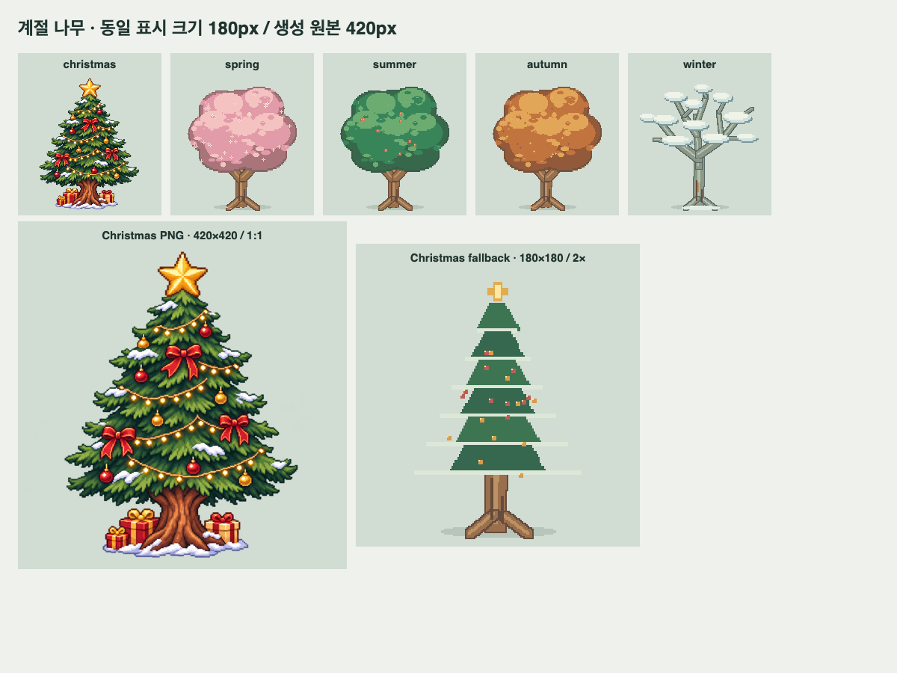
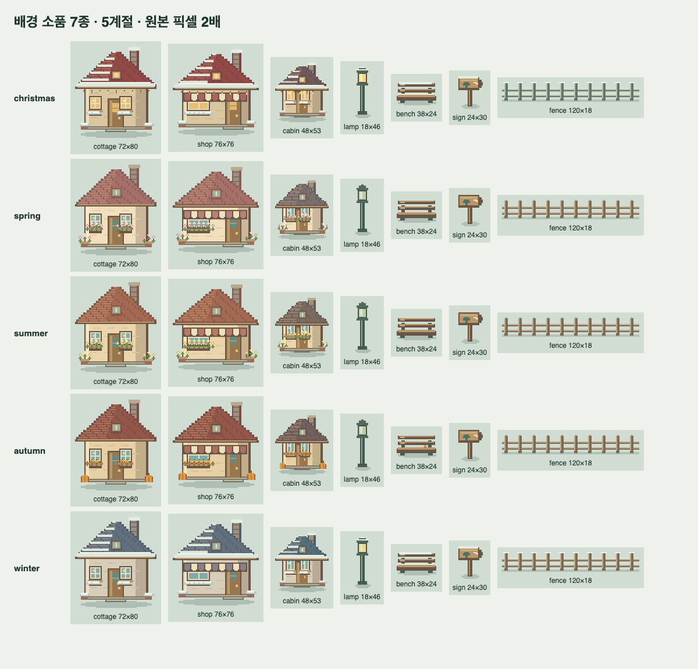

# 현재 픽셀 에셋 평가

2026-11-25, 기준 소스30d4f58 / 공개 production1a1111e3. 픽셀아트 관점의 자체 평가다. 사용자 요청은 평가이며 제품 에셋의 교체/코드 수정/추가 배포는 수행하지 않았다. 숫자로 임의 점수를 매기기보다 유지/보완/재제작으로 판정한다.

전체 인상은 ‘개성이 있는 소형 마을, 그러나 하나의 아트 규칙으로 마감되지는 않은 상태’다. 보존 가치가 큰 자산은 캐릭터8종과 건물/소품이다. 가장 큰 개선 지점은 계절 나무 사이의 그림체, 모바일 축소 방식, 현재 제품과 다른 홍보물이다. 모든 에셋을 새로 만들 필요는 없다.

## 확인 범위와 순서

| 단계 | 새로 확인한 증거 | 상태 |
| --- | --- | --- |
| 1 | 공개 설치 화면의5개 계절,1487px 데스크톱 | 작동 정상. 나무의 밀도/형태가 계절마다 불균일. |
| 2 | 공개375/320px 마을 | 작동 정상. 나무 디테일 손실과 캐릭터 밀집이 뚜렷함. |
| 3 | 현재 소스를 렌더한8의상×3방향×8프레임=192개 시트 | 시트 완성. 실루엣/모자/가방/표정/손 인사 확인. |
| 4 | 정상 나무5종+실패 시 대체 나무1종,소품7종×5계절 | 시트 완성. 나무와 작은 집의 리샘플링 보완 필요. |
| 5 | 산타/루돌프 각2프레임,말풍선3종,땅/하늘/소나무/광장 | 사용 가능. 움직임/광원/형태의 마감 보완 권고. |
| 6 | 공개 이동 장면250ms 간격4회,영상/포스터/GIF/로고 | 실제 이동 확인. 영상과 포스터는 이전 주소/배경을 포함. |

공개 장면은 실제 서비스의 캡처다. 검사용 시트는 로컬 Vite에서 현재 함수의 픽셀 버퍼/Canvas를 직접 그린 것으로 새로운 에셋이나 개편 시안이 아니다. DPR1, nearest/pixelated 확대를 사용했다. 모든 채택 이미지를 열어 확인했다. 최초 캐릭터 시트의 잘린 마지막 행과 중복 스트립이 생긴 캡처,영상6.8초의 탐색 중 로딩 프레임은 제외하고 다시 촬영했다.

현재 조사 캡처는 [에셋 폴더](../../../assets/pixel-audit-2026-11-25/),측정은 같은 폴더 inventory.json/motion-media.json에 있다. 과거 문서의 화면을 이번 평가 증거로 재사용하지 않았다.

## 우선 지적

**P1 — 중앙 나무의 유효 픽셀 크기와 묘사 규칙이 다르다.** 크리스마스는 촘촘한 잎/전구/리본/입체 명암이 있는420×420 PNG다. 다른 계절은180×180에 큰 색면으로 그린다. 같은 크기로 나란히 놓으면 크리스마스는 상세한 삽화,다른 나무는 단순한 게임 스프라이트로 읽힌다. 크기만 다른 것이 문제는 아니며 실제 픽셀 묶음/윤곽/명암 밀도의 차이가 핵심이다. 하나의 기본 도트 크기/윤곽/광원/명암 단계로 다시 맞추는 것이 최우선이다. [나무 비교](../../../assets/pixel-audit-2026-11-25/04-trees.png).

**P1 — 모바일에서는 에셋의 상대 크기가 달라진다.** 375px 화면의 마을은311×200 CSS px,내부 Canvas는156×100이다. 캐릭터는 약40×56 CSS px를 유지하지만 나무 표시 상자는 약138×138px로 줄어든다.420px 트리 장식이69px 내부 크기에 압축돼 점처럼 뭉개진다.320px의256×200 마을에서는 가로로 캐릭터 몸통이 더 겹친다. 이는 원화만의 결함이 아니라 축소/배치 문제다. 실제24명 입력은 보존하고,작은 화면용 단순한 트리/소품과 화면 높이/배치를 먼저 검토한다. 임의로 일부 인원을 숨기는 해결은 제품 원칙에 맞지 않는다. [375](../../../assets/pixel-audit-2026-11-25/02-mobile-375.png),[320](../../../assets/pixel-audit-2026-11-25/02-mobile-320.png).

**P1 — 소개 영상/포스터가 현재 제품을 보여 주지 않는다.**19.5초 엔딩과 포스터에 `pixel-visitor-village.vercel.app`이 남아 있다. 현재 Pages 주소와 다르고 집/사계절 나무/광장도 이전 외형이다. GIF도 같은 이전 배경을 쓴다. 현재 아트로 재렌더하고 주소를 갱신해야 한다. 이 평가는 이전 도메인의 현재 HTTP 상태를 판정하지 않는다. [영상 엔딩](../../../assets/pixel-audit-2026-11-25/08-video-19.5.png),[사계절 장면](../../../assets/pixel-audit-2026-11-25/08-video-11.5.png),[현재 GIF 캡처](../../../assets/pixel-audit-2026-11-25/08-readme-gif.png).

## 나무 전체

| 에셋 | 좋은 점 | 보완점과 판정 |
| --- | --- | --- |
| 크리스마스 트리 | 별→수관→선물로 시선이 내려가고,빨강/금색이 분명한 주인공이다. 수관 층과 비대칭 장식이 풍부하다. | 작은 렌더 크기에서 잎/전구/반사가 경쟁한다. 형태와 장식 배치는 보존하고 제한된 명암과 큰 픽셀 묶음으로 정리. **스타일 통일 재작업/P1**. |
| 봄나무 | 분홍 수관과 작은 꽃으로 계절이 즉시 구분된다. | 원형의 밝은 면이 반복돼 꽃송이의 뭉침보다 둥근 덩어리 무늬가 먼저 보인다. 윤곽을 비대칭으로 깨고 꽃의 크기/간격에 큰 묶음과 빈 곳을 만든다. **재작업/P1**. |
| 여름나무 | 넓고 짙은 녹색 수관,작은 붉은 열매의 대비가 좋다. | 봄과 같은 실루엣/색면 패턴이라 계절 전환이 색 교체처럼 읽힌다. 가지가 받치는 방향과 잎의 아래/윗면을 구분한다. **재작업/P1**. |
| 가을나무 | 황토/주황이 지면과 부드럽게 연결된다. | 봄/여름과 같은 외곽과 점무늬다. 일부 가지와 빈틈,수관의 비대칭 낙엽량으로 형태도 바꾼다. 단순 채도 증가만으로 해결하지 않는다. **재작업/P1**. |
| 겨울나무 | 잎이 없는 가지와 눈 덩이가 계절을 명확히 바꾼다. | 굵기가 균일한 직선 분기와 평평한 눈 받침이 기계적으로 보인다. 가지 끝을 점차 가늘게 하고 눈 무게/처짐을 단계형 윤곽으로 표현한다. 지면과 명도가 가까워 밑동이 약하다. **보완/P2**. |
| 크리스마스 대체 나무 | 원본 로드 실패에도 의미를 유지하고 기능을 중단하지 않는다. | 떨어져 보이는6개 삼각 층과 십자 별이 정상 트리와 큰 차이를 만든다. 정상 트리의 동일 실루엣/장식 위치를 단순화한 저해상도 버전을 권장한다. **보완/P2**. |

동일 Canvas 측정에서 크리스마스 PNG는 가시 RGBA 조합51,566개,다른 계절 나무는12~14개였다. 원본 파일의 가시 RGB는43,239개다. 색 수가 적어야 무조건 좋은 것은 아니지만 이 경우 화면에서 확인한 묘사 방식의 차이를 뒷받침한다. PNG는 다양한 반투명 가장자리도 포함하며 대부분의 몸체 알파가250 이상이다. 알파가 있다는 이유만으로 결함이라고 판정하지 않으며 어두운/밝은 바탕에서 가장자리를 정리하는 검토가 필요하다.

## 캐릭터8종 전체

[앞면192프레임 중64개](../../../assets/pixel-audit-2026-11-25/03-characters-front.png),[옆면64개](../../../assets/pixel-audit-2026-11-25/03-characters-side.png),[뒷면64개](../../../assets/pixel-audit-2026-11-25/03-characters-back.png).

20×28px/외곽1px/발 기준선/3방향의 공통 골격이 잘 정리돼 있다. 모자와 귀/머리/가방으로 단순 색 교체 이상의 차별화도 있다. 전체 재제작을 권하지 않는다. 주의할 부분은 넓은 사각형 머리,비슷한 눈/코트,복장이 모두 두꺼워 사계절 구분이 적다는 점이다. 마지막 항목은 현재 기능 오류가 아니라 선택적인 확장 과제다.

| 캐릭터 | 판정 | 개별 평가 |
| --- | --- | --- |
| 딸기 우편배달부 | 유지,소폭 보완 | 베레모 꼭지/가방/분홍색 조합이 가장 빨리 읽힌다. 작은 화면에서는 가방이 팔과 합쳐지므로 몸통과의 빈 픽셀을 지키면 좋다. |
| 민트 산책가 | 유지,대비 보완 | 줄무늬 모자와 밝은 목도리가 안정적이다. 여름의 녹색 바탕에서 코트가 약해져 외곽/밝은 면의 대비 확인이 필요하다. |
| 노란 우비 친구 | 유지 | 가장 강한 색 대비와 후드의 명확한 프레임으로 작은 화면에서 잘 보인다. 얼굴 구멍의 직사각형 느낌은 둥근 후드 모서리2~3군데만 조정해도 줄어든다. |
| 라벤더 리본 | 유지,실루엣 보완 | 검은 머리와 보라 코트가 구별된다. 리본이 작아 옆/뒤에서 머리 윤곽이 다른 맨머리 캐릭터와 비슷해지므로 리본의 위치/돌출을 다듬는다. |
| 숲속 정원사 | 유지,대비 보완 | 옆면 챙이 좋은 식별점이다. 초록 배경에서는 정면 모자/옷이 묻히므로 밝은 챙과 목도리 면을 보존한다. |
| 밤색 책방지기 | 유지 | 안경이 작은 캔버스에서도 직업 인상을 만든다. 안경의 밝은 두 사각형이 눈보다 강하므로 외곽과 렌즈 안쪽 밝기를 한 단계 조절할 여지가 있다. |
| 크림 곰돌이 | 유지,대비 보완 | 양쪽 귀가 색 없이도 구분되는 좋은 실루엣이다. 눈밭에서 코트와 배가 약하므로 몸통 아래 음영과 배경 분리를 우선한다. |
| 밤하늘 털모자 | 유지,개성 보완 | 방울과 파랑/보라의 조합이 안정적이다. 민트 모자와 기본 형태가 유사해 방울/모자 높이 또는 목도리 끝 한 요소를 더 차별화할 수 있다. |

### 캐릭터 동작

- 대기/걷기4/깜박임/손 인사2가8프레임 안에 갖춰져 있고 방향 전환도 준비돼 있다. 프레임별 작은 상하 이동이 있어 뻣뻣한 스티커보다는 생물로 읽힌다. 손 인사는 제한된 픽셀로 뜻이 잘 전달된다.
- 옆면의 발 이동과 팔 흔들림은 읽히지만 체형/어깨 회전은 제한적이다. 새 프레임 수를 늘리기 전에 접지하는 발의 위치와 통과 자세를 먼저 다듬는 편이 낫다.
- 실제 공개 장면을250ms씩4회 샘플링해 이동을 확인했다. 샘플8명 중2/4/5/6/7번이 움직였으며 모든 인물이 동시에 멈췄다고 판단하지 않았다. 프레임 시트 검토와 짧은 재생 관찰이며 전체 동작에 대한 동영상 품질 인증은 아니다.
- 소스상 이동 속도는 화면 크기에 영향을 받지만 발 프레임 주기는 고정6Hz다. 폭별 발 미끄러짐은 추가 정밀 검토 대상으로 남긴다. 이번 샘플만으로 모든 화면에 접지 결함이 있다고 단정하지 않는다.

## 건물과 소품7종 전체

| 에셋/기본 캔버스 | 평가 | 권장 조치 |
| --- | --- | --- |
| 작은 집72×80 | 처마/굴뚝/창틀/현관이 읽히고 따뜻한 벽과 지붕이 조화롭다. 눈/꽃/호박이 계절을 연결한다. | **유지/P2**. 지붕 기와1px 반복을 조금 줄여 창/현관을 더 선명하게. |
| 가게76×76 | 차양과 넓은 창이 작은 집과 구분된다. | **유지/P2**. 지붕/건물 외곽이 작은 집과 거의 같아 간판 또는 지붕 높이 하나를 차별화. |
| 작은 오두막62×68 | 먼 거리 건물 역할과 색 차이가 좋다. | **보완/P2**. 실제520×260 배치에서는48×53으로 먼저 축소되며 얇은 창틀/꽃이 손실된다. 작은 버전은 다시 그린 간략 스프라이트가 유리하다. |
| 가로등18×46 | 기둥/유리/지붕의 세 부분이 작은 크기에서도 명확하다. | **유지/P2**. 야간 주변 지면의 약한 빛 면을 추가하면 ‘밝은 창문색’ 이상의 조명이 된다. |
| 벤치38×24 | 등받이/좌판/다리와 눈이 간결하고 좋은 픽셀 묶음으로 읽힌다. | **유지**. 시점/하이라이트를 공통 규칙에 맞추는 정도. |
| 표지판24×30 | 나무/화살표라는 의미는 충분하며 색이 장면에 맞는다. | **유지**. 작은 그림을 더 넣기보다 화살표의 빈 공간을 지켜 읽기 쉽게. |
| 울타리100×18 기준,실제 폭 가변 | 전경을 묶고 세계의 경계를 만든다. 크리스마스/겨울의 눈이 잘 연결된다. | **유지/P2**. 기둥 간격이 규칙적이라 기계적인 반복이 보인다. 끝기둥/눈 덩이2~3변형으로 완화. |

작은 집/가게와 벤치/램프의 품질 차이는 크지 않아 한 세트로 보인다. 다만 모든 그림자의 방향이 뚜렷하게 통일돼 있지는 않고,여러 소품을 비정수 비율로 축소한 뒤 nearest 확대한다. 화면을 선명하게 하는 설정과 픽셀 두께를 균일하게 유지하는 일은 별개다.

## 배경/장식/효과 전체

[산타/루돌프/말풍선/땅](../../../assets/pixel-audit-2026-11-25/06-guests-bubbles-ground.png),[크리스마스 장면](../../../assets/pixel-audit-2026-11-25/01-scene-christmas.png),[겨울 장면](../../../assets/pixel-audit-2026-11-25/01-scene-winter.png).

| 대상 | 평가와 판정 |
| --- | --- |
| 하늘/원경 언덕/두 층의 소나무 | 채도/대비를 낮춰 전경 인물을 받치는 역할이 좋다. 다만 소나무 실루엣 반복은 강하다. **유지**,크기/기울기/간격 변형만 보완. |
| 별/달/구름 | 별과 구름은 조용한 배경에 적절하다. 달은 막대형에 가깝고 주인공 별보다 조형이 약하다. **유지/P3**,달만 계단형 초승달로 다듬을 여지. |
| 눈/잔디 바닥 | 계절색이 안정적이지만 잔디/눈 획의 간격이 규칙적으로 반복돼 화면이 무늬처럼 보인다. **보완/P2**,텍스처를 성긴 곳/모인 곳으로 나누고 보행 공간은 비운다. |
| 중앙 광장/진입 길/포장석 | 방문자가 모이는 구조를 잘 설명한다. 타원과 세로 길의 T자 결합이 인공적이다. **보완/P2**,타원 가장자리와 길 폭을 약간 비대칭으로 정리. |
| 화단/화분/호박/낙엽 | 작은 크기로 계절을 보완하는 경제적인 자산이다. **유지**. 여름의 꽃/가을 열매는 더 복잡하게 만들 필요가 없다. |
| 접지 그림자 | 떠 보이는 것을 줄이며 고정 발 그림자가 실용적이다. **보완/P2**,나무/건물/인물의 광원 방향과 그림자 명도를 공통화. |
| 눈 입자 | 사각 도트와 적은 색이 잘 맞는다. **유지**,깊이별2~3크기/속도로 조용한 원경과 전경을 구분하면 좋아진다. |
| 봄 꽃잎/가을 낙엽 입자 | 계절은 읽히지만 같은 사각형 입자라 실제 꽃잎/잎보다 색종이에 가깝다. **보완/P2**,2~3개의 작은 비대칭 모양을 권장. |
| 나무 발광 | 축제의 온기는 좋다. 부드러운 방사형 그라데이션은 딱딱한 도트와 다른 처리다. **의도 결정/P2**,모든 발광은 부드럽게 허용하거나 단계형 빛 면으로 통일. |
| 산타32×36/2프레임 | 수염/모자/자루/손 인사가 작은 크기에서 읽힌다. 일반 인물보다 큰 장식 캐릭터라는 위계도 명확하다. **유지/P2**,반복 손 인사에 몸통 반응1px 정도면 충분. |
| 루돌프32×36/2프레임 | 뿔/붉은 코/목도리가 잘 구분된다. 두 프레임 다리 차이가 작고 몸통이 고정돼 발만 깜빡이는 인상이 있다. **보완/P2**,한 발 접지/반대발 통과와 몸통 이동을 연결. |
| 점 세 개/하트/반짝임18×14 | 공통 크림 면과 진한 외곽,짧은 꼬리가 안정적이다. **유지**. 장식을 늘리기보다 인물/다른 말풍선과의 간격을 지킨다. 색 외의 형태로도 세 의미가 구분된다. |

## 픽셀처럼 보이는 UI와 홍보 자산

- **나무 팻말:** 목재 배경과 매다는 줄이 세계에 어울리고 실제 숫자는 시스템 글꼴로 읽기 쉽다. 게임 에셋의1논리 픽셀과 CSS px는 별도다. 작은 화면에서 면적이 커져 나무를 가리므로 위치/노출 크기를 보완한다. ‘픽셀 폰트로 바꾸기’가 우선 해결책은 아니다.
- **브랜드 마크:** 실제 로고를 새로 캡처했다. 간결하고 색 역할은 좋지만 단독 실루엣은 나무보다 십자형으로도 읽힌다. **선택적 보완/P3**. UI 벡터 마크이며 게임 스프라이트와 같은 아틀라스에 넣을 필요는 없다.
- **이름표/저장소 배지:** 본문과 동작을 방해하지 않는 별도 HUD다. 픽셀아트가 아닌 텍스트 UI로 평가한다. 예술적 디테일보다는 모바일에서 그림을 가리는 면적을 줄이는 편이 중요하다.
- **소개 MP4:** 캐릭터8종 장면의 개성과 설명은 전달된다. 현재 제품과 다른 사계절 나무/집 및 이전 주소는 갱신 필요. 영상은 압축된 최종 결과이며 원본 스프라이트처럼 확대 품질을 기대하지 않는다.
- **포스터 JPG:** 별/나무/캐릭터 구도는 전달력이 있지만 이전 주소/그림이 박혀 있다. **교체/P1**. 사진용 손실 압축보다는 최종 용량을 비교해 선명한 PNG/WebP 포스터를 검토할 수 있다.
- **README GIF:** 짧은 자동 미리보기 역할은 좋지만 이전 배경과 단순한 집이 남아 있다. **현재 아트로 재렌더/P2**. GIF 팔레트 제한과 작은 크기를 고려해 미세 발광/잎의 점무늬를 줄인다.
- **생성 트리 마스터:** `assets/concepts/christmas-tree-v1.png`는 제작 원본이며 정상 표시용 PNG와 같은 자산 계열이다. 공개 배포용 스프라이트/레이어가 아니므로 별도 게임 자산으로 중복 집계하지 않는다. 현재 장식이 합성돼 있어 전구/리본의 개별 애니메이션에는 분리가 필요하지만 지금 기능에 필수인 것은 아니다.
- **과거 docs/assets 캡처와 디자인 시안:** 개발 기록/목업으로 남긴 이미지이며 현재 런타임 에셋으로 평가하거나 교체 대상으로 세지 않았다.

## 권장 수정 순서

1. **그림 규칙부터 확정:** 유효 도트 크기,1px 외곽선,윗왼쪽 광원,재질별3~4단계 명암,공통 그림자,불투명 몸체/제한된 반투명 효과를 정한다. ‘모든 에셋의 캔버스 크기를 같게’ 하는 것과 구분한다.
2. **중앙 나무 세트:** 크리스마스의 실루엣/장식 배치는 보존하고 다른 계절과 픽셀 묶음/명암 밀도를 맞춘다. 사계절은 색만이 아니라 수관의 형태/빈틈도 바꾼다. 대체 나무도 같은 원본의 단순 버전으로 연결한다.
3. **모바일 실제 사용 크기:** 작은 트리와 소품의 전용 변형,높이와 배치 조정을 비교한다. 인원수 의미는 보존하며 봄/여름/가을/겨울도 같은320/375px에서 확인한다.
4. **현재 홍보물 동기화:** 현재 Pages 주소와 새로운 나무/환경을 사용해 영상/포스터/GIF를 재렌더한다. 제품 원화가 확정된 뒤 수행하면 이중 작업을 줄일 수 있다. 구주소 표시는 먼저 수정 가능하다.
5. **캐릭터/배경 마감:** 캐릭터8종은 유지하고 저대비 의상,다리 접지,루돌프 동작,나뭇잎/눈 패턴과 광원만 다듬는다. 새 의상 추가는 이 작업 뒤다.

확인용 캡처의 pageerror는0건이다. 이 평가는 실제 렌더/원본/프레임을 대상으로 한 미술 평가이며 전체 접근성 준수,저사양 성능,실제 티스토리 집계나 모바일 실기기 호환을 인증하지 않는다. 색을 구분하기 어려운 사용자에게도 계절/인원 정보를 전달할 수 있는 텍스트가 존재하며 모션 줄이기 경로도 소스에서 확인했다. 이번에는 보조기기/광과민 반응의 전문 시험을 수행하지 않았다.
