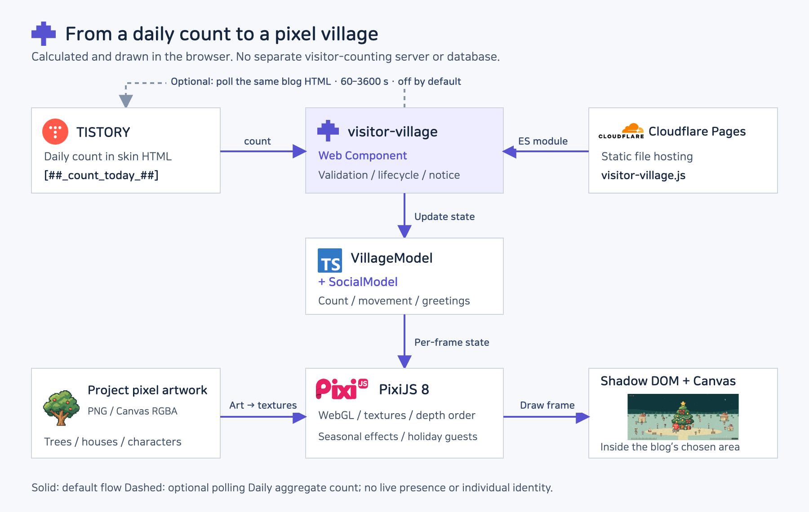
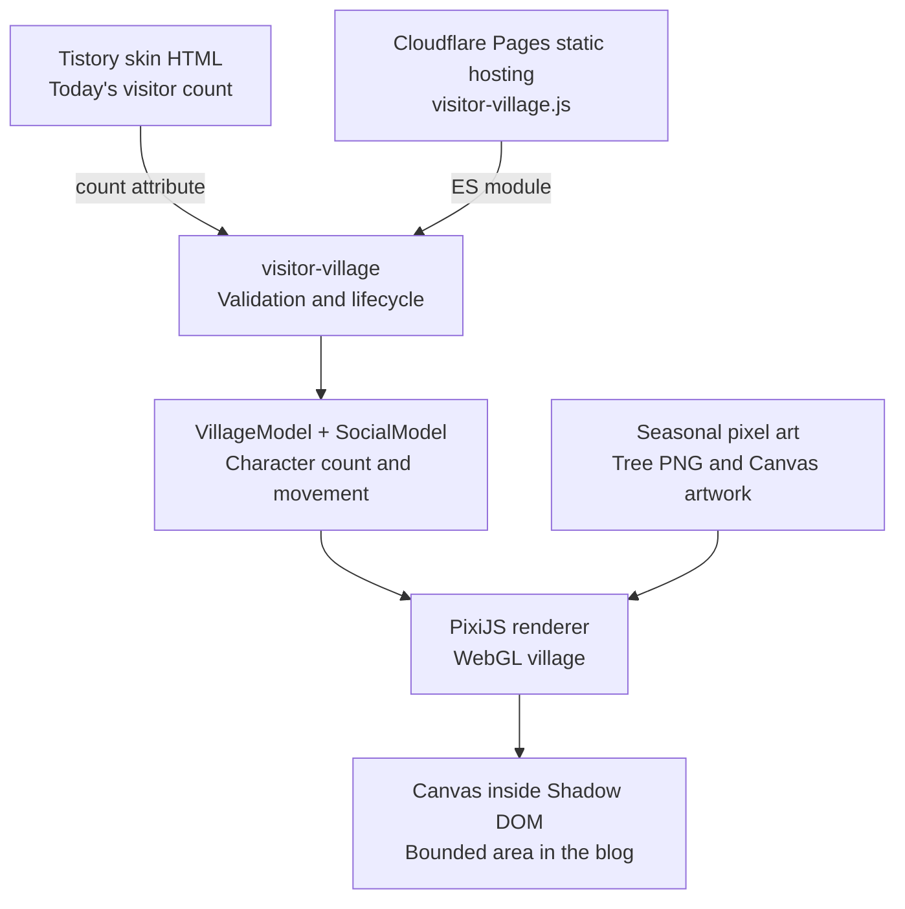

# Widget reference

[Back to README](../../README.en.md)

## Tistory installation

1. Open the [installation helper](https://pixel-visitor-village.pages.dev/install.html), enter your blog URL, choose a starting theme, and copy the code.
2. Back up your current skin. In Tistory administration, open **꾸미기 → 스킨 편집 → HTML 편집** (Appearance → Edit skin → Edit HTML).
3. Paste the code where the village should appear and save. Check the visitor count and mobile layout on your actual blog.

The helper generates an embed snippet and a link to your blog's administration page. **The blog owner must paste the code into the skin once.**

For manual installation, use:

```html
<script
  type="module"
  src="https://pixel-visitor-village.pages.dev/widget/visitor-village.js"
></script>

<visitor-village
  count="[##_count_today_##]"
  illustrated
  season="christmas"
  style="display: block; width: 100%; height: 420px;"
></visitor-village>
```

`illustrated` enables the artwork shown in the installer. New snippets include it; remove the attribute to use the original scenery.

Seasonal effects and a brief sparkle for an increase in today’s count are enabled by default. Set `effects="off"` to disable them. Reduced motion hides these decorations. Initial readings, decreases and day changes do not trigger the sparkle.

Tistory replaces `[##_count_today_##]` with today's visitor count **inside the skin HTML**. Placing it in an external JavaScript file or a regular blog post is unsupported. If the placeholder remains on the published page, check its location in the skin. If you use Tistory's automatic mobile skin, check whether it needs a separate installation.

Public deployment and loading the widget from another origin have been verified. **Installation in an actual Tistory account's skin still needs verification.** See the [deployment and installation guide (Korean)](../../docs/features/visitor-village/deployment.md).

## How it works

The widget reads the visitor count supplied when Tistory renders the page. No separate visitor tracking server or database is required.

[](../../docs/assets/architecture/architecture-en.svg)

<details>
<summary>Text version of the architecture</summary>



</details>

| Responsibility | Technology and source |
| --- | --- |
| Embedding and style isolation | Web Components, Shadow DOM — [visitor-village.ts](../../src/visitor-village.ts) |
| Input validation and movement | TypeScript — [model.ts](../../src/model.ts) |
| Rendering | PixiJS 8, WebGL — [renderer.ts](../../src/renderer.ts) |
| Trees and Tistory monument | Five seasonal PNGs and Canvas fallbacks — [village-art.ts](../../src/village-art.ts), [art.ts](../../src/art.ts) |
| Scenery and layout | Shared atlases for ground, houses, and props — [environment.ts](../../src/environment.ts), [environment-layout.ts](../../src/environment-layout.ts), [pixel-art.ts](../../src/pixel-art.ts) |
| Characters and motion | Original RGBA pixel frames and shared atlas — [characters.ts](../../src/characters.ts), [character-motion.ts](../../src/character-motion.ts) |
| Installation snippets | URL normalization and code generation in the browser — [install-model.ts](../../src/install-model.ts) |
| Build and hosting | Vite, Cloudflare Pages — [vite.widget.config.ts](../../vite.widget.config.ts), [wrangler.jsonc](../../wrangler.jsonc), [_headers](../../public/_headers) |

<details>
<summary>Repository layout</summary>

```text
pixel-visitor-village/
├── README.md / README.en.md / README.ja.md / README.zh-CN.md
├── index.html / install.html   # Demo and installation helper
├── src/                       # Widget, model, renderer, artwork, and helper
├── tests/widget.spec.ts        # Browser integration checks
├── examples/                  # Tistory embed snippet
├── public/embed-example.html  # Standalone embedding example
├── public/_headers / 404.html # Pages headers and missing-page handling
├── wrangler.jsonc             # Pages project and output settings
├── assets/concepts/           # Original tree concepts and generation notes
└── docs/
    ├── assets/                # Screenshots of the actual widget
    └── features/visitor-village/ # Spec, design, tasks, and review records
```

</details>

## Widget configuration

| Attribute | Default | Behavior |
| --- | --- | --- |
| `count` | `0` | Integer from 0 to 5,000; valid comma formatting such as `1,234` is accepted. Invalid or out-of-range input reports an error and preserves the last valid state. |
| `season` | `christmas` | `christmas`, `spring`, `summer`, `autumn`, or `winter`. Invalid input preserves the current season. |
| `paused` | Absent | Its presence pauses animation, including `paused="false"`. Remove the attribute to resume. |
| `glow` | Enabled | Set `glow="false"` to disable the Christmas tree's glow effect. Bulb colors painted into the image remain. |
| `refresh-interval` | `0` | Optional checking interval in seconds: `0` disables it; integers from `60` to `3600` enable it. Invalid values preserve the last valid setting. |

## Visitor notices and optional refresh

A small wooden sign drops into the village to show today's count. An increase shows the difference, such as “Today 13 (+3)” (the widget currently uses Korean labels). Repeated values do not replay the sign, and a new Korean calendar day does not count as an arrival. Clicking anywhere in the village opens the project repository in a new tab; keyboard navigation and mobile scrolling remain available.

Automatic checking is **off by default**. Add `refresh-interval="60"` to the existing tag, or select the one-minute option in the installation helper. Use `refresh-interval="0"` to disable it. The widget reads the current blog origin's home-page HTML while visible. That page must contain at least one widget with a valid count, and all widget counts on that page must agree. It does not execute the fetched page's scripts or load its images. Visible widgets in the same document share one request; failures preserve the last valid village and retry less often.

This checks the daily aggregate periodically, rather than receiving individual arrival events. Tistory's aggregation delay and the effect of repeated HTML requests on its statistics have **not been verified**. Enable checking only with that limitation in mind. The sign, link, and refresh option are available in the published widget. Existing installations may retain the previous module for up to five minutes.


<details>
<summary>JavaScript API and events</summary>

`visitorCount`, `season`, `ready`, and `motionReduced` are read-only. `getVisitors()` returns a copy of the `{ id, x, y }` array.

| Event | `detail` |
| --- | --- |
| `village-ready` | `{ count, season, paused }` |
| `village-change` | `{ count, season, paused }` |
| `village-error` | `{ attribute, message }` |

Events use `bubbles: true` and `composed: true`. The reported `paused` state includes the reduced motion preference. See the [public API contract (Korean)](../../docs/features/visitor-village/design.md#첫-버전-공개-계약).

</details>

## Local development

Use **Node.js 22.12+**, **pnpm 10**, and **Google Chrome** for browser checks.

```bash
pnpm install
pnpm dev --port 5174
```

Development URL: <http://127.0.0.1:5174/>

```bash
pnpm test       # Unit tests for input, models, and installation snippets
pnpm typecheck  # TypeScript checks
pnpm build     # Typecheck, then build the demo and standalone widget
pnpm test:e2e  # Check the built output in Chrome
pnpm preview   # http://127.0.0.1:4178/
```

The build writes the demo and installation helper to `dist/`, and the standalone ES module to `dist/widget/visitor-village.js`. The module includes PixiJS, internal styles, six landmark images and five seasonal backgrounds. Open `/examples/blog.html` to see the new generated widget in a blog body, or `/embed-example.html` for the original scenery.

Browser tests run installed Chrome in headless mode; mobile checks use emulation. Install Chrome or adjust `channel` in [playwright.config.ts](../../playwright.config.ts) for another browser setup.

For self-hosting, serve over HTTPS and allow cross-origin loading of the widget module. The `public/_headers` file adds CORS and five-minute cache/revalidation headers to `/widget/*`. Deployment uses Wrangler Direct Upload; automatic deployment from GitHub is not configured. See the [deployment guide (Korean)](../../docs/features/visitor-village/deployment.md) for configuration and verification records.

## Current scope

- **Visitor count:** Uses today's count supplied when the page opens. Characters do not represent concurrent users or individual identities.
- **Rendering:** Requires WebGL; a Canvas 2D fallback renderer is not implemented.
- **Tree customization:** Supports seasonal themes and Christmas glow control. Christmas decorations are part of a single PNG and cannot be edited individually.
- **Verification:** Public deployment and cross-origin embedding have been checked. Actual Tistory skin installation and testing on physical mobile devices remain.
- **License:** A distribution license for this repository has not yet been selected.

## Documentation and assets

The detailed documents linked here are in Korean.

| Document | Contents |
| --- | --- |
| [Requirements](../../docs/features/visitor-village/spec.md) | Feature scope and acceptance criteria |
| [Design](../../docs/features/visitor-village/design.md) | Architecture and public contracts |
| [Implementation plan](../../docs/features/visitor-village/implementation-plan.md) / [Progress](../../docs/features/visitor-village/tasks.md) | Work sequence and remaining tasks |
| [Deployment and installation](../../docs/features/visitor-village/deployment.md) | Cloudflare Pages configuration and installation checks |
| [Independent reviews](../../docs/features/visitor-village/reviews/) | Code and installation flow review records |
| [Tree concepts and generation notes](../../assets/concepts/README.md) | AI-generated Christmas tree concepts and prompts |
| [Introduction video credits](../../docs/features/visitor-village/intro-media.md) | Current-screen capture, HyperFrames editing, video details and music license |
| [Screenshot notes](../../docs/assets/README.md) | Sources and capture conditions for README images |

The five seasonal trees and Tistory monument use transparent PNGs in [src/assets/cozy](../../src/assets/cozy/). Generated originals and prompts are recorded in [asset provenance](../../assets/concepts/cozy/README.md). Fallback art remains in `src/art.ts`, scenery in `src/environment.ts`, and characters in `src/characters.ts`. No external game assets are used.

## Square frames and Christmas guests

The widget and demo use square corners. In the Christmas theme, an original pixel Santa or Rudolph occasionally appears for 5–8 seconds, then disappears. Only one decorative guest appears at a time; these guests never change the actual visitor count. Their clock pauses offscreen, in hidden tabs, or during manual pause. Reduced motion and other seasons hide them.

Nearby characters occasionally stop, face each other, wave, and exchange a tiny icon balloon before walking again. Up to three pairs interact at once (one on small screens). These are decorative reactions, independent of real visitor identities. Pausing freezes the interaction; reduced motion disables it.

These additions are available in the published widget.
