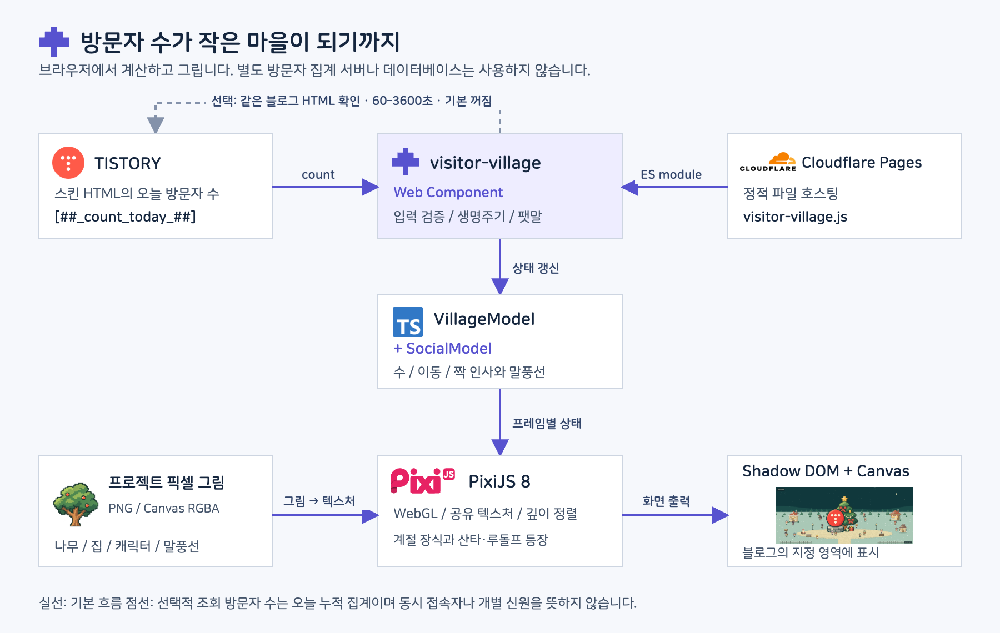
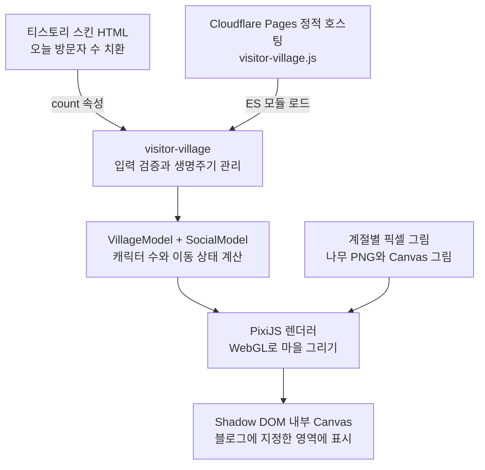

# 위젯 사용 참고

[README로 돌아가기](../../README.md)

## 티스토리 설치

1. [설치 도우미](https://pixel-visitor-village.pages.dev/install.html)에 블로그 주소와 처음 보여 줄 테마를 입력하고 코드를 복사합니다.
2. 사용 중인 스킨을 백업한 뒤, 티스토리 관리자 → **꾸미기 → 스킨 편집 → HTML 편집**을 엽니다.
3. 마을을 표시할 위치에 코드를 붙여 넣고 저장합니다. 실제 블로그에서 방문자 수와 모바일 화면을 확인합니다.

주소를 입력하면 설치 코드와 해당 블로그의 관리자 링크가 만들어집니다. **최초 한 번은 소유자가 스킨에 코드를 붙여 넣어야 합니다.**

직접 설치하려면 아래 코드를 사용합니다.

```html
<script
  type="module"
  src="https://pixel-visitor-village.pages.dev/widget/visitor-village.js"
></script>

<visitor-village
  count="[##_count_today_##]"
  illustrated
  season="christmas"
  style="display: block; width: 100%; height: 420px;"
></visitor-village>
```

`illustrated`는 설치 미리보기와 같은 계절 그림을 표시합니다. 새 설치 코드에 포함되며, 속성을 제거하면 기존 기본 풍경을 사용합니다.

계절 효과와 방문 수 증가 반짝임은 기본으로 켜집니다. `effects="off"`로 끌 수 있으며 모션 줄이기 설정에서는 자동으로 숨깁니다. 처음 표시한 수, 감소와 날짜 변경에는 반짝임을 재생하지 않습니다.

`[##_count_today_##]`는 **티스토리 스킨 HTML에서** 오늘 방문자 수로 치환됩니다. 외부 JavaScript 파일이나 일반 글 본문에 넣는 방식은 지원하지 않습니다. 실제 페이지에 치환자가 그대로 보이면 스킨의 삽입 위치를 확인해야 합니다. 자동 모바일 스킨을 사용하는 경우에도 별도 적용 여부를 확인합니다.

Cloudflare Pages 공개 배포와 다른 출처에서의 위젯 로드는 확인했습니다. **실제 티스토리 계정의 스킨 설치 검증은 아직 남아 있습니다.** 자세한 확인 순서는 [배포와 설치 안내](../../docs/features/visitor-village/deployment.md)를 참고하세요.

## 동작 구조

티스토리가 페이지를 만들 때 넣어 준 방문자 수를 입력으로 사용합니다. 별도 방문자 집계 서버나 데이터베이스는 필요하지 않습니다.

[](../../docs/assets/architecture/architecture-ko.svg)

<details>
<summary>텍스트로 동작 구조 보기</summary>



</details>

| 역할 | 기술과 파일 |
| --- | --- |
| 삽입과 스타일 분리 | Web Components, Shadow DOM · [visitor-village.ts](../../src/visitor-village.ts) |
| 입력 검증과 이동 계산 | TypeScript · [model.ts](../../src/model.ts) |
| 화면 그리기 | PixiJS 8, WebGL · [renderer.ts](../../src/renderer.ts) |
| 나무와 티스토리 조형물 | 다섯 계절 PNG와 Canvas 대체 그림 · [village-art.ts](../../src/village-art.ts), [art.ts](../../src/art.ts) |
| 마을 환경과 배치 | 바닥, 집과 소품의 공유 아틀라스 · [environment.ts](../../src/environment.ts), [environment-layout.ts](../../src/environment-layout.ts), [pixel-art.ts](../../src/pixel-art.ts) |
| 캐릭터 그림과 동작 | 자체 RGBA 픽셀 프레임과 공유 아틀라스 · [characters.ts](../../src/characters.ts), [character-motion.ts](../../src/character-motion.ts) |
| 설치 코드 생성 | 브라우저 안에서 주소 정규화와 코드 생성 · [install-model.ts](../../src/install-model.ts) |
| 빌드와 배포 | Vite, Cloudflare Pages · [vite.widget.config.ts](../../vite.widget.config.ts), [wrangler.jsonc](../../wrangler.jsonc), [_headers](../../public/_headers) |

<details>
<summary>저장소 구조</summary>

```text
pixel-visitor-village/
├── README.md / README.en.md / README.ja.md / README.zh-CN.md
├── index.html / install.html    # 데모와 설치 도우미 진입점
├── src/
│   ├── visitor-village.ts       # 공개 웹 컴포넌트
│   ├── model.ts                # 방문자 수 검증과 이동 모델
│   ├── renderer.ts             # PixiJS 화면과 자원 관리
│   ├── art.ts / themes.ts      # 계절 나무와 테마 설정
│   ├── environment.ts          # 지형, 집과 거리 소품 그림
│   ├── environment-layout.ts   # 반응형 소품 배치
│   ├── pixel-art.ts            # 공통 픽셀 그리기 도구
│   ├── characters.ts          # 8종 캐릭터의 픽셀 프레임
│   ├── character-motion.ts    # 방향, 걷기와 표정 선택
│   ├── demo.ts / demo.css      # 마을 시연 화면
│   ├── install*.ts / *.css     # 설치 도우미와 스타일
│   └── assets/                 # 배포용 계절 나무와 조형물
├── tests/widget.spec.ts        # 브라우저 통합 검증
├── examples/                   # 티스토리 삽입 코드
├── public/embed-example.html   # 독립 삽입 예제
├── public/_headers / 404.html   # Pages 헤더와 없는 경로 처리
├── wrangler.jsonc              # Pages 프로젝트와 출력 설정
├── assets/concepts/            # 나무 원본 시안과 생성 기록
└── docs/
    ├── assets/                 # 실제 화면 캡처
    └── features/visitor-village/ # 명세, 설계, 작업과 검토 기록
```

</details>

## 위젯 설정

| 속성 | 기본값 | 동작 |
| --- | --- | --- |
| `count` | `0` | 0~5,000의 정수. `1,234`처럼 올바른 쉼표 표기도 허용합니다. 잘못된 값이나 범위 초과는 안내하고 마지막 정상 상태를 유지합니다. |
| `season` | `christmas` | `christmas`, `spring`, `summer`, `autumn`, `winter`. 잘못된 값은 기존 계절을 유지합니다. |
| `paused` | 없음 | 속성이 존재하면 정지합니다. `paused="false"`도 정지이므로, 재생하려면 속성을 제거합니다. |
| `glow` | 켜짐 | `glow="false"`로 크리스마스 나무의 빛 번짐을 끕니다. 이미지에 그려진 전구색은 유지합니다. |
| `refresh-interval` | `0` | 선택적 확인 주기(초). `0`은 끄기이며 `60`부터 `3600`까지의 정수를 지원합니다. 잘못된 값은 마지막 정상 설정을 유지합니다. |

## 방문 수 팻말과 선택적 갱신

작은 나무 팻말이 위에서 내려와 오늘 방문 수를 알립니다. 숫자가 늘면 “오늘 방문 13 (+3)”처럼 증가분을 표시합니다. 같은 숫자는 다시 알리지 않으며 한국 날짜가 바뀐 뒤의 수를 새 방문으로 오인하지 않습니다. 마을 어디를 클릭해도 프로젝트 저장소가 새 탭으로 열립니다. 키보드 탐색과 모바일 스크롤도 유지합니다.

자동 확인은 **기본으로 꺼져 있습니다.** 기존 태그에 `refresh-interval="60"`을 추가하거나 설치 도우미의 1분 확인 옵션을 선택합니다. `refresh-interval="0"`은 확인을 끕니다. 화면에 보일 때 같은 블로그 출처의 홈페이지 HTML을 읽습니다. 홈페이지에 정상 방문 수를 가진 위젯이 있어야 하며 여러 위젯의 수가 다르면 오류로 처리합니다. 읽어 온 페이지의 스크립트나 이미지는 실행/로드하지 않습니다. 같은 문서의 보이는 위젯들은 한 요청을 공유하며 실패 시 마지막 정상 마을을 보존하고 재시도 간격을 늘립니다.

이 기능은 오늘 집계의 주기 확인이며 개별 방문의 도착 이벤트를 받는 방식은 아닙니다. 티스토리 집계 지연과 반복 HTML 조회가 집계에 미치는 영향은 **아직 검증하지 않았습니다.** 이 경계를 확인하고 선택해 사용합니다. 팻말과 링크, 갱신 옵션은 공개 위젯에 반영했습니다. 기존 설치에서는 이전 모듈이 최대 5분간 캐시될 수 있습니다.


<details>
<summary>JavaScript API와 이벤트</summary>

`visitorCount`, `season`, `ready`, `motionReduced`는 읽기 전용입니다. `getVisitors()`는 `{ id, x, y }` 배열의 복사본을 반환합니다.

| 이벤트 | `detail` |
| --- | --- |
| `village-ready` | `{ count, season, paused }` |
| `village-change` | `{ count, season, paused }` |
| `village-error` | `{ attribute, message }` |

이벤트는 `bubbles: true`, `composed: true`로 전파됩니다. `paused` 상태에는 모션 줄이기 설정도 반영됩니다. 전체 계약은 [공개 API 설계](../../docs/features/visitor-village/design.md#첫-버전-공개-계약)에 있습니다.

</details>

## 로컬 개발

Node.js **22.12 이상**, pnpm **10**, 브라우저 검증용 **Google Chrome**을 사용합니다.

```bash
pnpm install
pnpm dev --port 5174
```

개발 화면: <http://127.0.0.1:5174/>

```bash
pnpm test       # 입력과 모델, 설치 코드의 단위 테스트
pnpm typecheck  # TypeScript 검사
pnpm build     # 타입 검사 후 데모와 독립 위젯 빌드
pnpm test:e2e  # 빌드 결과를 Chrome에서 검증
pnpm preview   # http://127.0.0.1:4178/
```

`dist/`에 데모와 설치 도우미, `dist/widget/visitor-village.js`에 독립 ES 모듈이 생성됩니다. 모듈에는 PixiJS와 내부 스타일, 나무·조형물과 다섯 계절 배경이 포함됩니다. `/examples/blog.html`에서 새 설치 코드의 삽입 모습을, `/embed-example.html`에서 기존 기본 풍경을 확인할 수 있습니다.

브라우저 테스트는 설치된 Chrome을 headless로 실행하며 모바일은 에뮬레이션으로 확인합니다. Chrome이 없는 환경은 설치하거나 [playwright.config.ts](../../playwright.config.ts)의 `channel`을 조정합니다.

직접 호스팅할 때는 HTTPS와 위젯 모듈의 교차 출처 로드를 허용해야 합니다. Pages의 `public/_headers`는 `/widget/*`에 CORS와 5분 캐시/재검증 헤더를 제공합니다. 배포는 Wrangler로 직접 업로드하며 GitHub 자동 배포는 아직 설정하지 않았습니다. 상세 설정과 배포 확인 기록은 [배포 문서](../../docs/features/visitor-village/deployment.md)에 있습니다.

## 현재 범위

- **방문자 집계:** 페이지가 열릴 때 전달된 오늘 방문자 수를 사용합니다. 실시간 동시 접속자나 개별 방문자의 신원을 나타내지 않습니다.
- **렌더링:** 위젯은 WebGL을 사용합니다. WebGL을 사용할 수 없는 환경을 위한 Canvas 2D 대체 렌더러는 구현하지 않았습니다.
- **나무 꾸미기:** 계절 테마 선택과 크리스마스 빛 번짐 조절을 지원합니다. 크리스마스 장식은 하나의 PNG여서 장식별 편집은 지원하지 않습니다.
- **확인 범위:** 공개 배포와 교차 출처 삽입은 검증했으며, 실제 티스토리 스킨 설치와 모바일 실기기 검증은 남아 있습니다.
- **라이선스:** 이 저장소의 배포 라이선스는 아직 정하지 않았습니다.

## 문서와 에셋

아래 상세 문서는 한국어로 작성되어 있습니다.

| 문서 | 내용 |
| --- | --- |
| [요구사항](../../docs/features/visitor-village/spec.md) | 기능 범위와 수용 기준 |
| [설계](../../docs/features/visitor-village/design.md) | 구현 구조와 공개 계약 |
| [구현 계획](../../docs/features/visitor-village/implementation-plan.md) / [진행 상태](../../docs/features/visitor-village/tasks.md) | 작업 순서와 남은 일 |
| [배포와 설치](../../docs/features/visitor-village/deployment.md) | Cloudflare Pages 설정과 설치 확인 기록 |
| [독립 검토 기록](../../docs/features/visitor-village/reviews/) | 코드와 설치 흐름 검토 결과 |
| [나무 원본과 생성 기록](../../assets/concepts/README.md) | 현재 원화와 이전 나무 시안의 생성 기록 |
| [소개 영상 제작과 출처](../../docs/features/visitor-village/intro-media.md) | 최신 화면 캡처와 HyperFrames 편집, 영상 정보와 음악 라이선스 |
| [화면 캡처 안내](../../docs/assets/README.md) | 이 README에 사용한 실제 화면의 출처와 촬영 조건 |

현재 계절 나무5종과 티스토리 조형물은 [src/assets/cozy](../../src/assets/cozy/)의 투명 PNG입니다. 첨부 콘셉트로 제작한 생성 원본과 프롬프트는 [원화 기록](../../assets/concepts/cozy/README.md)에 있습니다. 대체 그림은 `src/art.ts`, 지형과 집/소품은 `src/environment.ts`, 캐릭터는 `src/characters.ts`에서 편집합니다. 외부 게임 에셋은 사용하지 않았습니다.

## 직각 프레임과 크리스마스 손님

위젯과 데모의 모서리는 직각으로 표시합니다. 크리스마스 테마에서는 자체 제작 픽셀 산타나 루돌프가 가끔 나타나 5~8초 머문 뒤 사라집니다. 동시에 한 명만 표시하며 실제 방문자 수에는 포함하지 않습니다. 화면 밖이나 숨긴 탭, 수동 정지에서는 연출 시계도 멈춥니다. 모션 줄이기 설정과 다른 계절에서는 손님을 숨깁니다.

가까운 캐릭터는 가끔 멈춰 서로 보고 손을 흔든 뒤 작은 아이콘 말풍선으로 반응하고 다시 걷습니다. 동시에 최대 세 쌍, 작은 화면에서는 한 쌍만 상호작용합니다. 실제 방문자의 신원과 관계없는 장식 연출입니다. 정지하면 인사도 멈추고 모션 줄이기 설정에서는 표시하지 않습니다.

이 변경은 공개 위젯에 반영했습니다.
